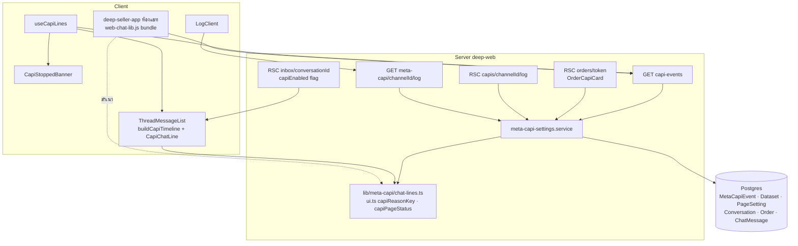
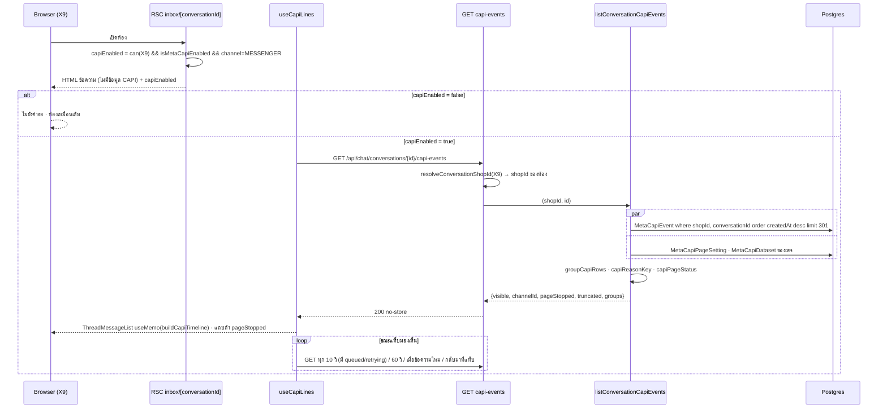
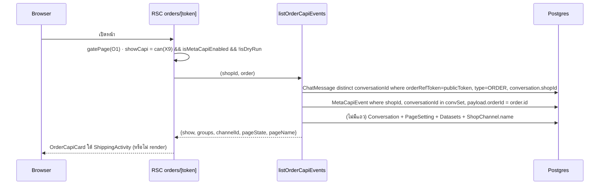
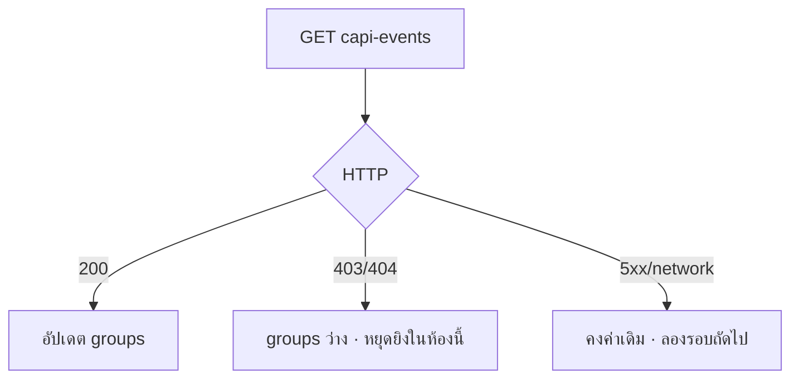

> **โมดูล:** 00097 - CAPI Event Log per Chat and Order
> **ประเภทเอกสาร:** System Design Spec (SDS)
> **เวอร์ชัน:** 0.1
> **วันที่จัดทำ:** 2026-11-16
> **สถานะ:** Draft
> **เจ้าของเอกสาร:** SA (ดู [[Feature-Docs-Ownership]])

# SDS: ดูเหตุการณ์ Conversions API ในห้องแชทและในคำสั่งซื้อ (System Design Spec)

---

## 1. บทนำ & References

### 1.1 วัตถุประสงค์
ออกแบบการ implement ของ [[SRS]] TFR-001..010: ไฟล์ที่สร้าง/แก้ · ทางไหลของข้อมูลจาก `MetaCapiEvent` ถึงบรรทัดในห้องแชท การ์ดคำสั่งซื้อ และหน้าบันทึก · การตัดสินใจทางเทคนิคพร้อมเหตุผล ผู้อ่าน: DEV เว็บ · DEV แอป · QA · Reviewer

### 1.2 ขอบเขตการออกแบบ
**deep-web (สร้าง):**
- `src/app/api/chat/conversations/[id]/capi-events/route.ts`
- `src/lib/meta-capi/chat-lines.ts` + `src/lib/meta-capi/__tests__/chat-lines.test.ts`
- `src/app/(paces)/seller/(chat)/inbox/[conversationId]/components/useCapiLines.ts` · `CapiChatLine.tsx` · `CapiStoppedBanner.tsx`
- `src/app/(paces)/seller/(dashboard)/orders/[token]/components/OrderCapiCard.tsx`

**deep-web (แก้):**
- `src/services/meta-capi-settings.service.ts` (`listConversationCapiEvents` · `listOrderCapiEvents` · `listCapiLog`)
- `src/lib/chat-scope.ts` (`ChatCap` + `"X9"`) · `src/lib/route-capabilities.ts` · `src/lib/validations.ts` (`CapiLogQuerySchema`)
- `src/app/api/shops/meta-capi/[channelId]/log/route.ts` (ส่งต่อคีย์ใหม่)
- `src/app/(paces)/seller/(chat)/inbox/[conversationId]/page.tsx` (flag `capiEnabled`) · `ChatThread.tsx` (ส่ง flag + แถบ) · `ThreadMessageList.tsx` (แทรกบรรทัด)
- `src/app/(paces)/seller/(dashboard)/_shared/useSellerChatThread.ts` — `groupByDate` รับ item ทั้งสองชนิด (หรือย้ายการจัดวันไปหลัง `buildCapiTimeline` ใน ThreadMessageList — เลือกตอน implement โดยไม่เปลี่ยน shape ที่ ChatWidget ใช้)
- `src/app/(paces)/seller/(dashboard)/orders/[token]/page.tsx` + `components/OrderDetailClient.tsx` (slot ใหม่ใต้ `shippingActivity`)
- `src/app/(paces)/seller/(dashboard)/settings/capis/[channelId]/log/page.tsx` + `components/LogClient.tsx`
- `src/i18n/dictionaries/th.ts` · `en.ts`
- `src/lib/native-chat-sync/manifest.ts` · `pins.json`
- คอมเมนต์ schema `MetaCapiEvent` (180 วัน → เก็บถาวร) — คอมเมนต์เท่านั้น

**deep-seller-app:** ดู §3 แถวแชท Native และ TD-006

**นอกขอบเขต:** schema/migration · ตัวส่ง/คิว 00089 · `CustomerPanel.tsx` (ไม่เปลี่ยน — D2′) · การ์ดคำสั่งซื้อใน Native

### 1.3 เอกสารอ้างอิง
| เอกสาร | ความสัมพันธ์ |
|--------|-------------|
| [[SRS]] ของโมดูลนี้ | ที่มาของข้อกำหนดเชิงเทคนิคที่ SDS ต้อง realize |
| [[BRD]] ของโมดูลนี้ | ที่มาของ Functional Requirements / AC |
| [[PRD]] ของโมดูลนี้ | ที่มาของเป้าหมายธุรกิจและ KPI |
| ม็อกอัพ `docs/superpowers/specs/2026-11-16-00097-capi-event-log-mockup.{html,md}` | Theme Source + โทเคน + anatomy ของบรรทัด/การ์ด/ชิป |
| `docs/20 - Features/00088 - Seller Native Chat/SDS.md` §3.0 | โครงแชท Native (bundle `web-chat-lib.js` · `WEB-SYNC.md`) |
| `docs/conventions/native-chat-sync.md` | ขั้นตอนเมื่อด่าน HR18 แดง |

---

## 2. Architecture Overview

### 2.1 มุมมองสถาปัตยกรรม
ชั้นอ่านอย่างเดียวบน outbox ของ 00089 ตาม convention เดิม: route → service (`src/services`) → Prisma · ตรรกะที่ตัดสินหน้าจออยู่ใน `src/lib` (ฟังก์ชันล้วน ใช้ได้ทั้ง server/client/bundle Native) · RSC คำนวณ flag สิทธิ์แล้วส่ง boolean ลงมา (ข้อมูลไม่ออกถ้าไม่มีสิทธิ์) · ห้องแชทดึงข้อมูลเพิ่มแบบ lazy หลังข้อความขึ้น ไม่แตะ store/delta ของข้อความ

### 2.2 มุมมองการ Deploy (ถ้าจำเป็น)
ไม่เปลี่ยน topology — route ใหม่เป็น Vercel Function ตามปกติ · ไม่มี env/cron/migration ใหม่ · ลำดับปล่อย: เว็บขึ้น prod ก่อน → แอปเวอร์ชันที่เรียก `capi-events` ตามมา (แอปเก่าไม่เรียก)

---

## 3. Component Design

| Component | หน้าที่ (Responsibility) | Dependency (Submodule / Stack / Store) |
|-----------|--------------------------|-----------------------------------------|
| **`capi-events/route.ts`** | ด่าน (401/400/404/403) → `isMetaCapiEnabled` → service → `json()` no-store · ห่อ `capiRun` | `chat-scope.resolveConversationShopId('X9')` · `forbiddenRoleResponse` · `route-helpers.ts` |
| **`listConversationCapiEvents`** | ห้อง (ร้าน + Messenger) · แถว ≤301 · setting + datasets ของเพจ · `groupCapiRows` · `pageStopped` | Prisma → Postgres · `lib/meta-capi/chat-lines.ts` · `ui.ts` |
| **`listOrderCapiEvents`** | convSet · แถว JSON-path · กลุ่ม · `pageState`/ชื่อเพจ/`channelId` | Prisma → Postgres |
| **`listCapiLog` (ขยาย)** | where `conversationId` / convSet + JSON-path · select `sentAt` | Prisma → Postgres |
| **`chat-lines.ts`** | `groupCapiRows` · `capiGroupResult` · `buildCapiTimeline` · `capiNeedsFastRefresh` · ชนิด `CapiLineGroup` | ไม่มี (pure TS) — import ได้เฉพาะ `ui.ts`/`events.ts` ที่ pure |
| **`useCapiLines`** | state `{groups, channelId, pageStopped}` · รอบรีเฟรช TFR-004 · single-flight · abort | `fetch` · `document.visibilityState` |
| **`CapiChatLine`** | วาดบรรทัดเดี่ยว/บรรทัดรวม/กำลังส่ง + กล่องกาง | Base: theme `apps/chat/components/ChatPage.tsx` (แถว `my-5`) ผ่านพี่น้อง systemNotice `META_NOTICE` ใน `ThreadMessageList.tsx` · กล่องกาง = `ui/collapse/page.tsx` · Iconify tabler |
| **`CapiStoppedBanner`** | แถบ "หยุดส่ง · ต้องเชื่อมเพจใหม่" + ลิงก์ตั้งค่า | Base: พี่น้อง `BotPausedBanner.tsx` |
| **`OrderCapiCard`** | การ์ด timeline: รายการ · ว่าง · เพจยังไม่เปิด · ผิดพลาด | Base: theme `apps/ecommerce/(orders)/order-details/components/ShippingActivity.tsx` ผ่าน `orders/[token]/components/ShippingActivity.tsx` |
| **`log/page.tsx` + `LogClient`** | resolve ชิป · ส่งตัวกรอง · ซ่อนคอลัมน์ลูกค้า · "Meta รับเมื่อ" · ไอคอนในป้าย | `SellerEmptyState`/`SellerErrorState` เดิม |
| **แชท Native (deep-seller-app)** | endpoint + parser · วาดบรรทัด/กล่องกาง/แถบ · รอบรีเฟรช (AppState) · เปิดหน้าบันทึกบนเว็บ | `src/features/chat/api/endpoints.ts` · `api/parse.ts` · `vendor/web-chat-lib.js` (สร้างจาก `scripts/web-chat-lib.entry.ts`) · ไฟล์รายการข้อความใน `src/features/chat/ui/` · `WEB-SYNC.md` — ชื่อไฟล์หน้าห้องในแอป **ยังไม่ได้ยืนยัน** (รีโปแอปไม่อยู่ในเครื่องที่เขียนเอกสาร) |
| **native-chat-sync manifest** | เพิ่ม `SyncEntry`: `chat-lines.ts` · `ui.ts` (`capiReasonKey`) · `events.ts` · ก้อนคำ `conversionsApi.chat`/`logStatus`/`logReason`/`statusStopped` · route ใหม่ถูกเฝ้าโดย `WATCHED_DIRS` `src/app/api/chat` อยู่แล้ว | `src/lib/native-chat-sync/manifest.ts` · `pins.json` · `scripts/native-chat-sync-pin.ts` |

---

## 4. Data Flow

### 4.1 Flow หลัก: เปิดห้องแชทแล้วเห็นบรรทัด

### 4.1b Flow: การ์ดคำสั่งซื้อ

### 4.2 Flow กรณีล้มเหลว / ชดเชย (ถ้ามี)
- route ล้ม/timeout → `useCapiLines` เก็บ `groups` เดิม (หรือว่าง) ไม่แสดงข้อผิดพลาด · ลองรอบถัดไป · 403/404 → หยุดถาวรในห้องนั้น
- `listOrderCapiEvents` throw → RSC จับ แสดงการ์ดสถานะผิดพลาด + "ลองใหม่" (`router.refresh()` ในหน้า dashboard) — การ์ดอื่นไม่กระทบ
- ไม่มีการเขียนข้อมูล ⇒ ไม่มี compensating action · ไม่มีปัญหา consistency ข้าม store (store เดียว)

---

## 5. Integration Points

| จุดเชื่อม | ประเภท (internal/external/3rd-party) | Protocol / Contract | ความเสี่ยงเมื่อล่ม |
|-----------|--------------------------------------|----------------------|---------------------|
| **ตัวส่ง CAPI 00089 (`sweepMetaCapi`)** | internal | เขียน `status`/`sentAt`/`reason`/`attempts` บนแถวเดียวกัน | ค้าง "กำลังส่ง" — ตรงกับความจริงของคิว |
| **ด่านสิทธิ์แชท (`chat-scope.ts`)** | internal | `resolveConversationShopId(session, id, cap)` | ด่านผิด = รั่ว → เทสสิทธิ์ |
| **deep-seller-app** | internal (คนละรีโป) | REST JSON `GET /api/chat/conversations/{id}/capi-events` (คุกกี้ session ของ WebView ผ่าน `modules/deep-cookies` ตามแชท Native เดิม · `chatApi` ใน `src/features/chat/api/client.ts`) | แอปไม่ตาม = ไม่มีบรรทัดใน Native |
| **Meta Graph** | external | ไม่ถูกเรียก | — |

- **Timeout / Retry / Idempotency:** GET อ่านอย่างเดียว idempotent · client ไม่ retry ทันที (รอรอบถัดไป) · single-flight กันคำขอซ้อน
- **สัญญา API เต็ม:** ดู `API.md` ของโมดูลนี้

---

## 6. Technical Decisions

### TD-001: ส่งบรรทัดผ่าน endpoint แยก ไม่ฝังใน messages API
- **ตัดสินใจ:** `GET /api/chat/conversations/[id]/capi-events` คืนกลุ่มทั้งห้อง (≤300 แถว) · client แทรกตามเวลาตอน render
- **เหตุผล:**
  1. messages API มี cursor/delta สองแกน (`afterSeq` + `afterUpdatedAt`) + client store + การแทนหน้าแรก (R13/R28/R33 ใน `useSellerChatThread.ts`) — แถว CAPI ไม่มี `seq` และการเปลี่ยนสถานะไม่แตะ `ChatMessage.updatedAt` ⇒ delta จับการเปลี่ยน "กำลังส่ง → Meta รับแล้ว" ไม่ได้เลย ต้องสร้างแกนที่สามในเส้นทางที่ซับซ้อนที่สุดของแชท
  2. ตัดข้อมูลสำหรับผู้ไม่มี X9 ง่ายและพิสูจน์ได้ที่ route เดียว (403) แทนการแตก shape ของ messages ตามสิทธิ์ (cache/store ของข้อความใช้ร่วมระหว่างผู้ใช้หลายบทบาทบนเครื่องเดียวไม่ได้ถ้า shape ต่างกัน)
  3. ไม่ต้องกันบรรทัดหลุดเข้า store/แคชสลับห้อง/ตัวนับ/พรีวิว (BR-VIS-04) — อยู่คนละเส้นทางโดยโครงสร้าง
  4. Native เรียก endpoint เดียวกัน ไม่ต้องแก้ parser ของข้อความที่ใช้อยู่
  5. เหตุการณ์ต่อห้องมีน้อย (หลักสิบแถว) ⇒ ดึงทั้งห้องครั้งเดียวไม่ต้องมี `since/before` — การแบ่งหน้าตามข้อความทำฝั่ง client (`buildCapiTimeline` ซ่อนกลุ่มที่เก่ากว่าข้อความที่โหลด)
- **ทางเลือกที่ตัดทิ้ง:** (ก) ฝังใน messages API — เหตุผลข้อ 1–3 · (ข) เขียนเป็นแถว `ChatMessage` ชนิดใหม่ — ขัดมติ D4 (ต้องกันส่งออก/นับ/พรีวิว และสถานะเปลี่ยนภายหลังไม่ได้) · (ค) `since/before` ตามหน้าข้อความ — ซับซ้อนกว่าโดยไม่มีประโยชน์ที่ปริมาณนี้ (ทางอัปเกรดถ้า `truncated` พบบ่อย)
- **ผลกระทบ:** DEV: hook ใหม่ 1 ตัว ไม่แตะ store ข้อความ · QA: ทดสอบรอบรีเฟรชแยกจาก realtime · DevOps: คำขอเพิ่มเฉพาะเจ้าของร้านในห้อง Messenger ของร้านทดลอง

### TD-002: อัปเดตสดด้วยการดึงใหม่ ไม่ใช้ realtime broadcast
- **ตัดสินใจ:** interval 10 วิขณะมี queued/retrying · 60 วิปกติ · บวกตอนข้อความใหม่/กลับมาที่แท็บ
- **เหตุผล:** ตัวส่งเปลี่ยนสถานะใน cron (ไม่มี trigger broadcast) · ช่อง `chat:{conversationId}` ถูกออกแบบให้ห้ามมีเนื้อหา และทุกคนในห้อง (รวมผู้ไม่มี X9) subscribe ได้ ⇒ ใช้ส่งข้อมูล CAPI ไม่ได้ · การดึงใหม่ใช้ดัชนีห้อง ถูก
- **ทางเลือกที่ตัดทิ้ง:** broadcast สัญญาณจากตัวส่ง — ต้องแตะตัวส่ง 00089 + ช่องใหม่แยกสิทธิ์ เกินขนาดงาน · ผูกกับ poll 12 วิของ `useSellerChatThread` — ผูกสองฟีเจอร์เข้าด้วยกันโดยไม่จำเป็น
- **ผลกระทบ:** "กำลังส่ง" เปลี่ยนช้าสุด ~10 วิหลังแถวเปลี่ยน · ไม่ต้องแก้ realtime

### TD-003: กรองคำสั่งซื้อด้วย JSON path ภายใต้ `conversationId IN convSet` — ไม่มี migration
- **ตัดสินใจ:** `where { shopId, conversationId: { in: convSet }, payload: { path: ['orderId'], equals: orderId } }` · convSet จาก `Order.conversationId` + `ChatMessage(orderRefToken)` (มีดัชนี)
- **เหตุผล:** ดัชนี `(conversationId, eventKey, createdAt)` มีอยู่แล้ว · แถวต่อห้องน้อย กรอง JSON ในชุดเล็กถูก · convSet ครอบกรณีการ์ดถูกส่งในห้องอื่น (INITIATE_CHECKOUT/CART_ABANDONED ใช้ `conversationId` ของข้อความ ไม่ใช่ของคำสั่งซื้อ — `meta-capi.service.ts`)
- **ทางเลือกที่ตัดทิ้ง:** คอลัมน์ `orderId` + ดัชนี — ต้อง migration + backfill จาก payload (HR15) โดยยังไม่มีหลักฐานว่าช้า · JSON path อย่างเดียวกรองทั้งร้าน — สแกน `(shopId, createdAt)` ทั้งประวัติ (บันทึกเก็บถาวร โตไม่หยุด)
- **ผลกระทบ:** ต้องยืนยันแผน query บนข้อมูลจริงก่อน merge ([[DATABASE]] §5) — ไม่ผ่านจึงค่อย migration

### TD-004: สิทธิ์ตามร้านของห้อง (`resolveConversationShopId('X9')`) ไม่ใช่ร้าน active
- **ตัดสินใจ:** ขยาย `ChatCap` ให้รับ `"X9"` แล้วใช้ด่านแชทเดิม
- **เหตุผล:** กล่องแชทรวม (00037) เปิดห้องของร้านที่ไม่ใช่ร้าน active ได้ · ด่านนี้แยก 404 (คนนอก) / 403 (สมาชิกขาดสิทธิ์) ไว้แล้ว และอยู่ในรายการ GUARDS ของเทส `route-capability-inventory` · conventions/permission-gate-follows-the-row
- **ทางเลือกที่ตัดทิ้ง:** `requireShopCapability` (ร้าน active) — ผิดร้านในโหมดรวม · `resolveConversationShopId('H1')` + `can(X9)` เอง — ด่านสองชั้นที่ทำซ้ำของเดิม
- **ผลกระทบ:** type union เปลี่ยน 1 ค่า · ไม่กระทบผู้เรียกเดิม

### TD-005: บรรทัด/การ์ด/หน้าบันทึกใช้ฟังก์ชันรวมกลุ่มตัวเดียว
- **ตัดสินใจ:** `groupCapiRows` + `capiGroupResult` ใน `src/lib/meta-capi/chat-lines.ts` ใช้ทั้ง service (ฝั่ง server จัดกลุ่ม) และ UI (ผลของกลุ่ม/บรรทัดรวม) และ bundle ให้ Native
- **เหตุผล:** HR16 (นิยามเดียว) · conventions/ui-boolean-needs-a-testable-home · Native ได้กติกาเดียวกันทุกตัวอักษรผ่าน bundle เดิมของ 00088
- **ทางเลือกที่ตัดทิ้ง:** ตรรกะใน JSX — เทสจับไม่ได้ · server ส่งผลสำเร็จรูป (ข้อความไทย) — ผูกภาษากับ API ขัด i18n
- **ผลกระทบ:** ไฟล์อยู่ใน manifest native-chat-sync — แก้แล้วด่านแดงตามตั้งใจ

### TD-006: Native ทำบรรทัดในห้องรอบเดียวกัน (D3) ผ่าน endpoint เดียวกัน
- **ตัดสินใจ:** แอปเรียก `capi-events` ครั้งแรกเมื่อเปิดห้อง Messenger · 403/404/`visible:false` = ไม่วาด ไม่เรียกซ้ำในห้องนั้น · รอบรีเฟรชเท่าเว็บ (AppState แทน visibility) · "ดูในบันทึกการส่ง" เปิดหน้าเว็บ
- **เหตุผล:** แอปไม่มีข้อมูลสิทธิ์รายร้านล่วงหน้าแบบ RSC · คำขอแรกที่ถูกปฏิเสธมีค่าใช้จ่ายต่ำและไม่รั่ว
- **ทางเลือกที่ตัดทิ้ง:** เพิ่ม flag สิทธิ์ใน response ของห้อง — แตะ API ห้องที่ Native ใช้อยู่ เพิ่มพื้นที่ผิดพลาด
- **ผลกระทบ:** PR แอปคู่กับ PR เว็บ · `Native:` ใน PR เว็บ

### TD-007: การ์ดคำสั่งซื้อคำนวณใน RSC ไม่มี API
- **ตัดสินใจ:** `orders/[token]/page.tsx` เรียก `listOrderCapiEvents` แล้วส่ง `<OrderCapiCard>` เป็น slot ใหม่ของ `OrderDetailClient` ใต้ `shippingActivity`
- **เหตุผล:** หน้าเป็น RSC และมี `viewerRoles` อยู่แล้ว (`can(viewerRoles, …)` ใช้ทั่วหน้า) · ไม่มีผู้บริโภคอื่น (Native ไม่ทำรอบนี้) · ไม่ต้องอัปเดตสด
- **ทางเลือกที่ตัดทิ้ง:** API + client fetch — เพิ่ม route/ด่านโดยไม่มีผู้ใช้คนที่สอง
- **ผลกระทบ:** เพิ่ม 2–4 query ในหน้า (เฉพาะ X9 + ฟีเจอร์เปิด) · ห่อ try/catch แยกไม่ให้หน้าล้ม

---

## 7. Traceability

| SRS Requirement (TFR/NFR) | SDS Element (component / decision / flow) | สถานะ |
|---------------------------|-------------------------------------------|-------|
| TFR-001 | `capi-events/route.ts` · TD-001 · TD-004 · Flow 4.1 | Draft |
| TFR-002 | `listConversationCapiEvents` · TD-005 | Draft |
| TFR-003 | `chat-lines.ts` `buildCapiTimeline` · `CapiChatLine` · TD-005 | Draft |
| TFR-004 | `useCapiLines` · TD-002 · Flow 4.2 | Draft |
| TFR-005 | `CapiStoppedBanner` | Draft |
| TFR-006 | `listOrderCapiEvents` · `OrderCapiCard` · TD-003 · TD-007 · Flow 4.1b | Draft |
| TFR-007 | `listCapiLog` · `log/page.tsx` · `LogClient` · TD-003 | Draft |
| TFR-008 | `th.ts` · `en.ts` | Draft |
| TFR-009 | แชท Native · manifest · TD-006 | Draft |
| TFR-010 | TD-001 (คนละเส้นทางกับ store ข้อความ) | Draft |
| NFR Performance/Scalability | TD-002 · TD-003 · [[DATABASE]] §4–5 | Draft |
| NFR Security | TD-004 · route allow-list ฟิลด์ | Draft |

---

## 8. สรุป (Summary)

เอกสาร SDS นี้กำหนด **การออกแบบเชิงระบบ** ของ **มุมมองเหตุการณ์ CAPI ต่อห้องและต่อคำสั่งซื้อ** เพื่อให้ DEV นำไป implement,
QA นำความเสี่ยงไปวางแผนทดสอบ, และ DevOps ประเมินผลกระทบ infra ได้ตรงกับข้อกำหนดใน [[SRS]]

**ลำดับการ build ที่แนะนำ:**
1. `chat-lines.ts` + เทส unit (กลุ่ม · ผล · แทรก · รวมบรรทัด · fast-refresh)
2. service 3 ตัว + เทส DB (scope ร้าน · convSet · JSON path · ไม่มีฟิลด์ดิบ) · ยืนยันแผน query ([[DATABASE]] §5)
3. route `capi-events` + `ChatCap` + `route-capabilities.ts` + เทสสิทธิ์ · `CapiLogQuerySchema` + route log
4. คำ th/en (รวม "Meta รับแล้ว" + คำเตือนลบชุดข้อมูล)
5. หน้าบันทึก (ชิป · ซ่อนคอลัมน์ · Meta รับเมื่อ · ไอคอน)
6. ห้องแชทเว็บ (flag · hook · บรรทัด · แถบ) — ผ่าน `safepay-ux` ก่อน (HR8)
7. การ์ดคำสั่งซื้อ
8. manifest + pins + PR แอป Native → `Native:` ใน PR เว็บ
9. QA เบราว์เซอร์ + impeccable critique/clarify

**Open Questions:**
- ชื่อไฟล์หน้าห้องแชทในแอป Native — ยืนยันตอนเปิดรีโปแอป
- ถ้า EXPLAIN บนข้อมูลจริงไม่ใช้ดัชนีห้อง → migration ดัชนี `(conversationId, createdAt)` (ต้องแจ้ง user 3 ข้อตาม HR15 ก่อน)
