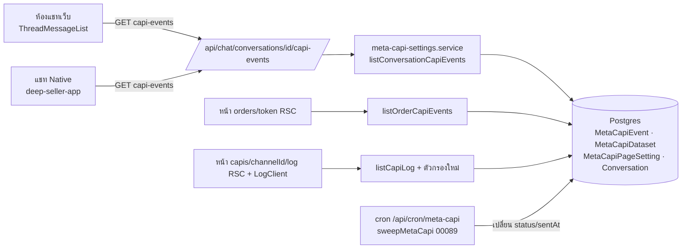
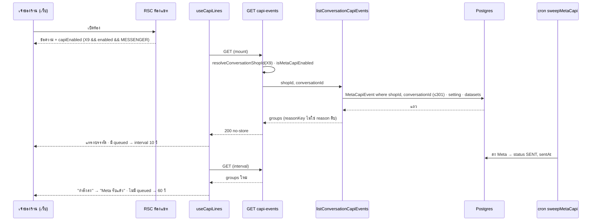
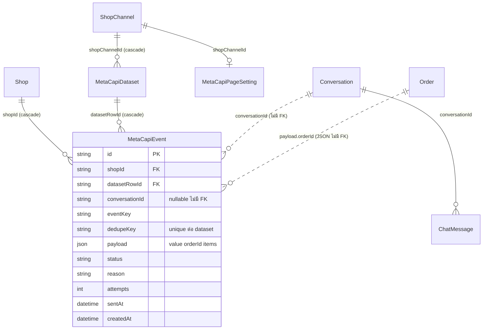

> **โมดูล:** 00097 - CAPI Event Log per Chat and Order
> **ประเภทเอกสาร:** Software Requirements Specification (SRS) - TECHNICAL
> **เวอร์ชัน:** 0.1
> **วันที่จัดทำ:** 2026-11-16
> **สถานะ:** Draft — เขียนจากโค้ดบน `origin/main` (`91f323e2e`) หลัง PRD/BRD อนุมัติ 2026-11-16
> **เจ้าของเอกสาร:** SA (ดู [[Feature-Docs-Ownership]])

# SRS: ดูเหตุการณ์ Conversions API ในห้องแชทและในคำสั่งซื้อ (Software Requirements Specification — Technical)

---

## 1. บทนำ (Introduction)

### 1.1 วัตถุประสงค์ของเอกสาร
กำหนดข้อกำหนดเชิงเทคนิคของบรรทัดเหตุการณ์ CAPI ในห้องแชท (เว็บ + Native) · การ์ดเหตุการณ์ในหน้ารายละเอียดคำสั่งซื้อ · ตัวกรองแชท/คำสั่งซื้อในหน้าบันทึกการส่ง · การเปลี่ยนคำสถานะ "สำเร็จ" → "Meta รับแล้ว" ผู้อ่าน: DEV (เว็บ + deep-seller-app) · QA · Reviewer

### 1.2 ขอบเขตเชิงระบบ (System Scope)
**ในขอบเขต (deep-web):**
- route ใหม่ `GET /api/chat/conversations/[id]/capi-events` (X9)
- service ใหม่ใน `src/services/meta-capi-settings.service.ts`: `listConversationCapiEvents` · `listOrderCapiEvents` · ขยาย `listCapiLog` (ตัวกรอง `conversationId`/`orderToken` + select `sentAt`)
- lib ฟังก์ชันล้วน `src/lib/meta-capi/chat-lines.ts` (รวมกลุ่ม · ผลของกลุ่ม · แทรกในไทม์ไลน์ · รวมบรรทัดติดกัน) — ใช้ร่วมเว็บ + bundle ให้ Native
- UI: `ThreadMessageList.tsx` (บรรทัด) · หัวห้องใน `ChatThread.tsx` (แถบเพจหยุดส่ง) · หน้า `orders/[token]` (การ์ด) · หน้า/`LogClient.tsx` ของบันทึก (ชิป · ซ่อนคอลัมน์ · Meta รับเมื่อ) · `th.ts`/`en.ts`
- `CapiLogQuerySchema` + route log ส่งต่อพารามิเตอร์ใหม่ · `route-capabilities.ts` · `ChatCap` เพิ่ม `"X9"`
- native-chat-sync manifest + pins

**ในขอบเขต (deep-seller-app):** บรรทัดในห้องแชท Native + แถบเพจหยุดส่ง (§3 TFR-009)

**นอกขอบเขต:** ตาราง/คอลัมน์/ดัชนีใหม่ (ไม่มี migration — [[DATABASE]]) · การเขียนแถว `ChatMessage` · realtime broadcast ใหม่ · การ์ดคำสั่งซื้อใน Native · ปุ่มส่งซ้ำ · การเปลี่ยนตัวส่ง/คิวของ 00089

### 1.3 เอกสารอ้างอิง (References)
| เอกสาร | ความสัมพันธ์ |
|--------|-------------|
| [[PRD]] ของโมดูลนี้ | ที่มาของเป้าหมายธุรกิจและ KPI |
| [[BRD]] ของโมดูลนี้ | FR-001..011 · BR-* · ตารางมติ §8.6 |
| `docs/superpowers/specs/2026-11-16-00097-capi-event-log-mockup.{html,md}` | หน้าตา/โทเคน/คำ (ม็อกอัพที่อนุมัติ) — คำ "สำเร็จ" ในม็อกอัพถูกแทนด้วย "Meta รับแล้ว" ตาม D9 |
| `docs/20 - Features/00089 - Meta Conversion API/{SRS,DATABASE}.md` | ตารางคิว `MetaCapiEvent` · สถานะ/เหตุผล · ด่าน `isMetaCapiEnabled` |
| `docs/conventions/native-chat-sync.md` (HR18) | ด่านเว็บ = Native |
| `docs/conventions/ui-boolean-needs-a-testable-home.md` | ตรรกะรวมกลุ่มต้องอยู่ใน `src/lib` + เทส |
| `docs/conventions/permission-gate-follows-the-row.md` | สิทธิ์ตัดสินตามแถว (ร้านของห้อง) ไม่ใช่ตามจอ |

### 1.4 นิยามและตัวย่อ (Definitions & Acronyms)
| คำ/ตัวย่อ | ความหมาย |
|-----------|----------|
| **แถว** | 1 แถว `MetaCapiEvent` = เหตุการณ์ 1 ตัว → ชุดข้อมูล 1 ชุด |
| **กลุ่ม (group)** | แถวทุกชุดข้อมูลที่มี `dedupeKey` เดียวกัน (ร้านเดียวกัน) = 1 เหตุการณ์ธุรกิจ |
| **บรรทัด (line)** | สิ่งที่วาดในห้อง: 1 กลุ่ม หรือบรรทัดรวมของกลุ่ม ≥2 ที่ติดกัน |
| **queued** | `status='PENDING' AND reason IS NULL` (ยังไม่เคยยิง) — `capiReasonKey` คืน `queued` |
| **X9** | capability ตั้งค่า/ดู Meta CAPI (`shop-permissions.ts` `X9: [O]`) |
| **convSet ของคำสั่งซื้อ** | `{Order.conversationId} ∪ {ChatMessage.conversationId ที่ type='ORDER' และ orderRefToken = Order.publicToken}` |

---

## 2. ภาพรวมสถาปัตยกรรม (Architecture Overview)

### 2.1 บริบทระบบ (System Context)



### 2.2 องค์ประกอบหลัก (Components)
| Component | หน้าที่ | Submodule / Stack |
|-----------|---------|-------------------|
| **`capi-events` route** | ด่านสิทธิ์ X9 ตามร้านของห้อง · ห้อง Messenger · เรียก service · no-store | deep-web Next.js route handler |
| **`listConversationCapiEvents`** | อ่านแถวของห้อง (เพดาน 300) · รวมกลุ่ม · สถานะเพจหยุดส่ง | `src/services/meta-capi-settings.service.ts` · Prisma |
| **`listOrderCapiEvents`** | หา convSet · อ่านแถวที่ `payload.orderId` ตรง · รวมกลุ่ม · สถานะเพจ | เดียวกัน |
| **`listCapiLog` (ขยาย)** | ตัวกรอง `conversationId`/`orderToken` · select `sentAt` | เดียวกัน |
| **`chat-lines.ts`** | ฟังก์ชันล้วน: `groupCapiRows` · `capiGroupResult` · `buildCapiTimeline` (แทรก + รวมบรรทัด) · `capiNeedsFastRefresh` | `src/lib/meta-capi/` (ไม่ import server) |
| **`useCapiLines` hook** | ดึง/รีเฟรชตามนโยบาย TFR-004 · ล้มเงียบ | ข้าง `ThreadMessageList.tsx` ใน `(chat)/inbox/[conversationId]/components/` |
| **`CapiChatLine` / `CapiStoppedBanner`** | วาดบรรทัด/กล่องกาง/แถบ | `(chat)/inbox/[conversationId]/components/` |
| **`OrderCapiCard`** | การ์ดในหน้าคำสั่งซื้อ | `orders/[token]/components/` |
| **แชท Native** | สำเนาตรรกะผ่าน bundle + หน้าจอบรรทัด | deep-seller-app `src/features/chat/**` |

### 2.3 มุมมองการ Deploy (Deployment View)
ไม่มีของใหม่ในเชิง runtime — route ใหม่รันเป็น Vercel Function ตัวเดียวกับ route แชทอื่น · ตัวส่ง CAPI (cron ทุก 1 นาที) ไม่เปลี่ยน · ไม่มี env ใหม่ (ใช้ `OPEN_META_CAPI` / `META_CAPI_PILOT_SHOP_IDS` เดิม) · ไม่มี migration ⇒ push `main` ไม่มีผลต่อ schema · แอป Native ออกเวอร์ชันแยกตามรอบของแอป (เว็บต้องขึ้นก่อน เพราะแอปเรียก API ใหม่ — แอปเวอร์ชันเก่าไม่เรียก ไม่กระทบ)

---

## 3. ข้อกำหนดเชิงฟังก์ชันเชิงเทคนิค (Technical Functional Requirements)

### TFR-001: route `GET /api/chat/conversations/[id]/capi-events` + ด่านสิทธิ์
- **Trace to:** FR-001 · FR-005 · FR-006 · FR-011 · BR-VIS-01..03 · BR-PII-01
- **คำอธิบายเชิงเทคนิค:**
  1. `session` → `sessionUserId` ไม่มี = 401
  2. `id` ผ่าน `v.pipe(v.string(), v.uuid())` ไม่ผ่าน = 400
  3. `resolveConversationShopId(session, id, "X9")` (ขยาย `ChatCap` ใน `src/lib/chat-scope.ts` ให้รับ `"X9"`) — `null` = 404 · `{denied}` = 403 `FORBIDDEN_ROLE` (`forbiddenRoleResponse()`) — **ร้านมาจากห้อง ไม่ใช่ร้าน active** (กล่องแชทรวม 00037)
  4. `isMetaCapiEnabled(shopId)` ไม่ผ่าน = 404 `{error:"ไม่พบหน้านี้", code:"FEATURE_DISABLED"}` ผ่าน `capiRun` (เท่ากับ API 00089)
  5. `listConversationCapiEvents(shopId, id)` → 200 · header `Cache-Control: private, no-store, max-age=0, must-revalidate` (`json()` จาก `route-helpers.ts`)
  6. ประกาศใน `src/lib/route-capabilities.ts`: `'src/app/api/chat/conversations/[id]/capi-events/route.ts': { GET: 'X9', status: 'DECLARED' }`
- **Precondition:** ผู้ใช้ล็อกอิน · ห้องมีอยู่
- **Postcondition:** response ไม่มี `psid` `pageId` `lastRequest` `lastResponse` `lastHttpStatus` `reason` (ดิบ) `payload` (ทั้งก้อน) `dedupeKey` · มีเฉพาะฟิลด์ใน [[API]] §4.1
- **Error / Edge cases:** ทุกทางที่ปฏิเสธต้องไม่มี key `groups` ใน body · ห้องไม่ใช่ Messenger = 200 `{visible:false, groups:[], pageStopped:false, channelId:null, truncated:false}` (ไม่ใช่ error — Native ไม่ต้องแยกกรณี) · อ่านอย่างเดียว ไม่มี side effect

### TFR-002: `listConversationCapiEvents(shopId, conversationId)`
- **Trace to:** FR-001 · FR-004 · BR-SCOPE-01 · BR-GRP-01..03 · BR-EDGE-08
- **คำอธิบายเชิงเทคนิค:**
  1. `gate(shopId)` (ของเดิม) · อ่าน `Conversation where {id, shopId}` select `channel, shopChannelId, shopChannel{status}` — ไม่พบ/ไม่ใช่ `MESSENGER`/ไม่มี `shopChannelId` → `{visible:false,…}`
  2. ขนาน: (a) แถว `MetaCapiEvent where {shopId, conversationId}` `orderBy [{createdAt:'desc'},{id:'desc'}]` `take 301` select `id, dedupeKey, eventKey, status, reason, attempts, sentAt, createdAt, payload, dataset{label, datasetId}` (b) `MetaCapiPageSetting` ของ `shopChannelId` select `enabled` (c) `MetaCapiDataset where {shopId, shopChannelId}` select `status`
  3. `truncated = rows.length > 300` · ตัดเหลือ 300 · ถ้า truncated ทิ้ง **ทุกแถวที่ `dedupeKey` เดียวกับแถวที่ 301** (กลุ่มที่เก่าสุดที่ถูกตัดกลางชุด — implement จริง) เพื่อไม่ให้กลุ่มชุดข้อมูลขาดโผล่เป็น "Meta รับแล้ว 1 จาก 1"
  4. `groupCapiRows(rows)` (lib) → กลุ่มเรียง `at` เก่า → ใหม่ · ต่อกลุ่ม: `id` = id แถวแรกตามลำดับ `datasetId` · `eventKey` · `at` = `min(createdAt)` · `value` = `payload.value ?? null` (ตัวเลขจำกัด) · `datasets[]` เรียงตาม `dataset.label ?? datasetId`: `{label, datasetId, status, reasonKey: capiReasonKey(r), attempts, sentAt}`
  5. `pageStopped = capiPageStatus({enabled: setting?.enabled ?? false, datasets}) === 'stopped'`
  6. คืน `{visible:true, channelId, pageStopped, truncated, groups}` · `channelId` = `shopChannelId` เมื่อ `shopChannel.status !== "DISCONNECTED"` ไม่งั้น `null` (หน้าบันทึก/ตั้งค่าเพจที่ยกเลิกเชื่อมเปิดไม่ได้ — `loadChannel` ซ่อน) · `channelId:null` ⇒ `pageStopped=false` และ UI ไม่แสดงลิงก์ (BRD BR-EDGE-09)
- **Precondition:** ผ่าน TFR-001
- **Postcondition:** ไม่มีแถวของร้านอื่น (WHERE `shopId`) · `reason` ดิบไม่ออกจาก service (แปลงเป็น `reasonKey` แล้ว)
- **Error / Edge cases:** แถวที่ `payload` ไม่ใช่ object → `value:null` · `eventKey` ที่ไม่อยู่ใน `CAPI_EVENTS` (ข้อมูลเก่า) → ยังคืน ฝั่ง UI แสดง key ดิบตาม LogClient เดิม · ห้องถูกย้าย/ลบภายหลัง → แถวยังมี (ไม่มี FK) แต่ route คืน 404 เพราะหาห้องไม่เจอ

### TFR-003: แทรกบรรทัดในไทม์ไลน์ + รวมบรรทัดติดกัน (`chat-lines.ts`)
- **Trace to:** FR-001 · FR-002 · BR-GRP-01 · BR-GRP-02 · BR-GRP-04 · BR-TXT-02..04
- **คำอธิบายเชิงเทคนิค:**
  - `capiGroupResult(group)` → `{ kind: 'sending' | 'uniform' | 'mixed', status, worst, okCount, total, shortReasonKey, sentAt }`:
    - ทุกชุด `reasonKey==='queued'` → `sending`
    - ทุกชุด status เดียวกัน → `uniform` (`status`) · `shortReasonKey` = `reasonKey` ของชุดแรก (ยกเว้น `none`)
    - ไม่เท่ากัน → `mixed` · `okCount` = จำนวนชุด `SENT` · `worst` ตามลำดับ `FAILED > PENDING > SKIPPED > SENT`
    - `sentAt` = `max(sentAt)` เมื่อทุกชุด `SENT` (ใช้แสดง "Meta รับเมื่อ")
  - `buildCapiTimeline(messages, groups, { hasOlder })` → `Array<{type:'message', m} | {type:'capi', groups: Group[]}>`:
    1. ตัดกลุ่มที่ `at < messages[0].createdAt` ออก เมื่อ `hasOlder` (ยังมีข้อความเก่าไม่ได้โหลด — BRD FR-001 AC ข้อ 6) · ไม่มีข้อความเก่าแล้ว = แสดงทุกกลุ่ม
    2. merge ตามเวลา (กลุ่มที่ `at` เท่ากับข้อความ → ข้อความมาก่อน) — ข้อความ optimistic ที่ยังไม่มี `createdAt` จาก server อยู่ท้ายเสมอ
    3. กลุ่มที่ติดกัน (ไม่มี `message` คั่น) และวันเดียวกัน (เขตเวลาไทย) → item `capi` เดียวที่ `groups.length ≥ 2`
  - ตัวคั่นวัน: ไทม์ไลน์ที่รวมแล้วผ่าน `groupByDate` เดิม (ขยายให้รับ item ทั้งสองชนิด) — วันที่มีแต่บรรทัดได้ตัวคั่นของตัวเอง
  - ข้อความบรรทัดรวม: ทุกกลุ่ม `uniform SENT` → `chatLineGroupAllReceived` · ทุกกลุ่ม `sending` → `chatLineGroupSending` · นอกนั้น `chatLineGroupMixed` (`{ok}` = จำนวนกลุ่มที่ `uniform SENT`, `{n}` = จำนวนกลุ่ม) + ไอคอน `worst` ข้ามกลุ่ม
- **Precondition:** `messages` เรียงเก่า → ใหม่ตามที่ hook ห้องให้มา
- **Postcondition:** ฟังก์ชันล้วน ไม่แตะ DOM/เวลา (รับ `now` ไม่ได้ใช้) · output เสถียรเมื่อ input เท่าเดิม (ใช้ใน `useMemo`)
- **Error / Edge cases:** `groups` ว่าง → คืน messages เดิมห่อ `type:'message'` (ไม่เปลี่ยนลำดับ) · ข้อความ `META_NOTICE` นับเป็น `message` (คั่นกลุ่มได้)

### TFR-004: นโยบายรีเฟรช (เว็บ + Native)
- **Trace to:** FR-003 · FR-006
- **คำอธิบายเชิงเทคนิค:** hook `useCapiLines(conversationId, enabled)`:
  - `enabled` มาจาก RSC ของห้อง: `can(rolesOf(threadCtx), 'X9') && isMetaCapiEnabled(shopId) && conversation.channel === 'MESSENGER'` — false = ไม่ยิงคำขอเลย (BRD FR-005)
  - ยิงเมื่อ: mount · id ข้อความล่าสุดเปลี่ยน (ข้อความใหม่จาก realtime/poll/ส่งเอง) · `visibilitychange` → visible · interval
  - interval: `capiNeedsFastRefresh(groups)` (มีชุดที่ `reasonKey ∈ {queued, retrying}`) → 10 วิ · นอกนั้น 60 วิ · แท็บซ่อน = หยุด
  - single-flight (คำขอซ้อน = ข้าม) · `AbortController` เมื่อเปลี่ยนห้อง/unmount
  - ตอบ 403/404/อื่น ≠ 200 → `groups=[]` + หยุดยิงในห้องนั้น (ไม่ retry วน) · network error → เก็บค่าเดิม ลองรอบถัดไป
  - 🛑 ห้าม `router.refresh()` ใน `(chat)/**` · ไม่ฝังลงใน store/delta ของข้อความ
- **Postcondition:** "กำลังส่ง" เปลี่ยนเป็นผลภายใน ≤ 10 วิหลังแถวเปลี่ยน (+ เวลาตัวส่ง) ขณะแท็บมองเห็น
- **Error / Edge cases:** retrying รอ 1 → 5 นาที (`RETRY_DELAYS_MS`) — poll 10 วิตลอดช่วงนั้นยอมรับได้ (owner เท่านั้น · ห้อง Messenger · ร้านทดลอง · คำขออ่านดัชนีห้อง) · `waitToken` (ชุดหยุด) ไม่นับเป็น fast-refresh

### TFR-005: แถบ "เพจหยุดส่ง"
- **Trace to:** FR-004 · D13
- **คำอธิบายเชิงเทคนิค:** ใช้ `pageStopped` จาก TFR-002 · วาดแถบเดียวใต้หัวห้อง ตำแหน่ง/ท่าเดียวกับ `BotPausedBanner.tsx` · คำ `conversionsApi.statusStopped` ("หยุดส่ง · ต้องเชื่อมเพจใหม่") + ลิงก์ `/settings/capis/{channelId}` · ขณะ `pageStopped` บรรทัดที่ `shortReasonKey==='waitToken'` ไม่แสดงเหตุผลสั้น (กล่องกางยังแสดงเหตุผลเต็ม)
- **Precondition:** `visible && pageStopped`
- **Postcondition:** แถบหายเองเมื่อรีเฟรชรอบถัดไปหลังเชื่อมเพจใหม่ (สถานะชุดข้อมูลกลับ ACTIVE)

### TFR-006: การ์ดคำสั่งซื้อ (`listOrderCapiEvents`)
- **Trace to:** FR-007 · BR-SCOPE-02 · BR-SCOPE-03 · BR-EDGE-04/05/07
- **คำอธิบายเชิงเทคนิค:**
  1. หน้า `orders/[token]/page.tsx` (RSC · ด่าน `gatePage(session,'O1')` เดิม) คำนวณ `showCapi = can(viewerRoles,'X9') && isMetaCapiEnabled(shop.id) && !order.isDryRun` — false = ไม่เรียก service ไม่ render
  2. `listOrderCapiEvents(shopId, { id, publicToken, conversationId })`:
     - convSet = `order.conversationId` (ถ้ามี) ∪ `chatMessage.findMany({ where:{ orderRefToken: publicToken, type:'ORDER', conversation:{ shopId } }, select:{conversationId}, distinct:['conversationId'] })`
     - convSet ว่าง → `{ show:false }`
     - แถว: `metaCapiEvent.findMany({ where:{ shopId, conversationId:{ in: convSet }, payload:{ path:['orderId'], equals: order.id } }, orderBy:[{createdAt:'desc'},{id:'desc'}], select: …เท่า TFR-002 + dataset.shopChannelId })` · ไม่จำกัดจำนวน (≤ 9 เหตุการณ์ × 3 ชุด × จำนวนห้องที่ส่งการ์ด)
     - `groupCapiRows` → เรียงใหม่ → เก่า
     - `channelId` สำหรับลิงก์ = `Conversation(order.conversationId).shopChannelId` ถ้าเป็น Messenger · ไม่งั้น `dataset.shopChannelId` ของแถวล่าสุด
     - `pageState` = `'rows' | 'empty' | 'off'` (มีแถว = `rows`) · `channelId` เป็น `null` เมื่อเพจ DISCONNECTED (เหมือนห้อง — implement จริง) · ไม่มีแถว และห้องของคำสั่งซื้อเป็น Messenger → `MetaCapiPageSetting.enabled && datasets.length>0` ? `'empty'` : `'off'` (+ ชื่อเพจ `ShopChannel.name`) · ไม่มีแถว และไม่ใช่ห้อง Messenger → `show:false`
  3. ล้ม (throw) → การ์ดสถานะผิดพลาด "โหลด event ไม่สำเร็จ" + "ลองใหม่" (`router.refresh()` ได้ เพราะอยู่ใน `(dashboard)` ไม่ใช่ `(chat)`) · ไม่ทำให้หน้าล้ม
- **Postcondition:** ลิงก์ `/settings/capis/{channelId}/log?order={publicToken}`
- **Error / Edge cases:** แถวที่ `payload.orderId` ตรงแต่ `shopId` ไม่ตรง → ไม่ออก (WHERE) · ห้องที่ส่งการ์ดคนละเพจ → ยังรวมในการ์ด (ลิงก์ชี้เพจเดียว — ข้อจำกัด §7.1)

### TFR-007: ตัวกรองหน้าบันทึกการส่ง
- **Trace to:** FR-008 · D12
- **คำอธิบายเชิงเทคนิค:**
  - `CapiLogQuerySchema` เพิ่ม `conversation?: v.pipe(v.string(), v.uuid())` · `order?: v.pipe(v.string(), v.maxLength(64))` (publicToken)
  - route log ส่งต่อคีย์ `["status","eventKey","conversation","order","cursor","take"]`
  - `CapiLogQuery` เพิ่ม `conversationId?: string` · `orderToken?: string` · `listCapiLog`:
    - `conversationId` → where `conversationId`
    - `orderToken` → `order.findFirst({ where:{ publicToken, shopId }, select:{ id, conversationId, publicToken } })` · ไม่พบ → คืน `{rows:[], nextCursor:null}` · พบ → convSet (เท่า TFR-006) + where `conversationId in convSet AND payload.path['orderId'] = id`
    - select เพิ่ม `sentAt` · row เพิ่มฟิลด์ `sentAt`
  - หน้า RSC `log/page.tsx`: อ่าน `?conversation=`/`?order=` → resolve ชิป: ห้อง `conversation.findFirst({ id, shopId, shopChannelId: channelId })` → `externalContact.name ?? t.logNoName` · คำสั่งซื้อ `order.findFirst({ publicToken, shopId })` → `orderNo ?? publicToken.slice(0,8)` · resolve ไม่ได้ = ทิ้งตัวกรองนั้น (ไม่มีชิป ไม่กรอง — BRD FR-008)
  - `LogClient` รับ `conversation`/`order`/`chips` · "โหลดเพิ่ม" ส่งตัวกรองครบ · `key` ของ LogClient รวมตัวกรองใหม่ · ชิป × = นำทางไป URL ที่ตัดคีย์นั้น · `conversation` มีค่า → ไม่สร้างคอลัมน์ `customer` (TanStack `columnVisibility`) และ mobileCard ไม่แสดงชื่อลูกค้า
  - แถว `SENT` แสดง `conversionsApi.logReceivedAt` = "Meta รับเมื่อ {date}" ด้วย `formatDayMonthTimeTH(sentAt)` ใต้ป้าย · ป้ายสถานะมีไอคอนนำ (ตามตารางม็อกอัพ)
- **Error / Edge cases:** `conversation` ไม่ใช่ uuid → 400 ที่ API (หน้า RSC ทิ้งเอง) · ห้องของร้านแต่คนละเพจ → ไม่มีชิป (where `shopChannelId`)

### TFR-008: คำสถานะ + คำเตือนลบชุดข้อมูล
- **Trace to:** FR-009 · FR-010 · D9 · D10 · HR16
- **คำอธิบายเชิงเทคนิค:** แก้ใน `src/i18n/dictionaries/th.ts` + `en.ts` (บล็อก `conversionsApi`):
  - `logStatus.SENT`: `'สำเร็จ'` → `'Meta รับแล้ว'` · en `'Sent'` → `'Received by Meta'`
  - `statsSent`: `'ส่งสำเร็จ'` → `'Meta รับแล้ว'` · en ตามกัน
  - `dsDeleteText` ต่อท้าย `' · บันทึกการส่งของชุดนี้จะถูกลบด้วย'`
  - คีย์ใหม่ (บล็อกย่อย `conversionsApi.chat` เพื่อให้ manifest ชี้เฉพาะก้อน): `line` `ส่ง “{label}” ให้ Meta` · `lineSending` `กำลังส่ง “{label}” ให้ Meta…` · `groupLine` `ส่ง {n} event ให้ Meta` · `groupAllReceived` `Meta รับแล้วทั้งหมด` · `groupMixed` `Meta รับแล้ว {ok} จาก {n}` · `groupSending` `กำลังส่ง {n} event ให้ Meta…` · `mixed` `Meta รับแล้ว {ok} จาก {n}` · `reasonShort.{rejected,maxAttempts,retrying,waitToken,tooOld}` · `openLog` `ดูในบันทึกการส่ง` · `expandAria`/`collapseAria`
  - คีย์ใหม่ระดับ `conversionsApi`: `logReceivedAt` `Meta รับเมื่อ {date}` · `orderCardTitle` `Event ที่ส่งให้ Meta` · `orderCardEmpty` `ยังไม่มีการส่ง event` · `orderCardPageOff` `เพจ {name} ยังไม่ได้เปิด Conversions API` · `orderCardGoSettings` `ไปตั้งค่า` · `orderCardError` `โหลด event ไม่สำเร็จ` · `orderCardRetry` `ลองใหม่` · `orderCardMixed` `Meta รับแล้ว {ok} จาก {n} ชุดข้อมูล` · `datasetsN` `{n} ชุดข้อมูล` · `chipConversation` `แชท: {name}` · `chipOrder` `ออเดอร์ #{no}` · `chipClearConversation` · `chipClearOrder`
  - เครื่องหมายคำพูดในคำใช้ `“ ”` ตามม็อกอัพ
- **Postcondition:** `rg "'สำเร็จ'" ` ในบล็อก `conversionsApi` ที่หมายถึงสถานะ SENT = 0 · ทุกคีย์ใหม่มีทั้ง th/en (เทส i18n parity เดิม)

### TFR-009: แชท Native (deep-seller-app)
- **Trace to:** FR-006 · BR-NAT-01 · HR18
- **คำอธิบายเชิงเทคนิค:**
  - เว็บ: ไฟล์ route ใหม่อยู่ใต้ `src/app/api/chat/**` และไฟล์ UI ใหม่ใต้ `(paces)/seller/(chat)/**` = โฟลเดอร์ที่ด่านเฝ้า ⇒ `native-chat-sync.test.ts` แดงจนกว่าจะปักหมุด · เพิ่ม `SyncEntry` ใน `src/lib/native-chat-sync/manifest.ts`: `src/lib/meta-capi/chat-lines.ts` (ทั้งไฟล์ → bundle `web-chat-lib.js`) · `src/lib/meta-capi/ui.ts` `from: 'export type CapiReasonKey'` (`capiReasonKey`) · `src/lib/meta-capi/events.ts` (ชื่อเหตุการณ์/ลำดับ) · `th.ts` ก้อน `conversionsApi.chat` · `logStatus` · `logReason` · `statusStopped` (ระบุ `from` ที่ไม่ซ้ำ)
  - แอป: `scripts/web-chat-lib.entry.ts` export ฟังก์ชันจาก `chat-lines.ts`/`capiReasonKey` → สร้าง bundle ใหม่ · `src/features/chat/api/endpoints.ts` + `api/parse.ts` (endpoint + parser ทนฟิลด์หาย) · หน้าห้องแชท (`src/features/chat/ui/` — ไฟล์รายการข้อความ) วาดบรรทัด/กล่องกาง/แถบ · ลิงก์ "ดูในบันทึกการส่ง" เปิดหน้าเว็บในตัวเปิดเว็บของแอป · นโยบายรีเฟรชเท่า TFR-004 (AppState แทน visibilitychange) · `src/features/chat/WEB-SYNC.md` เพิ่มรายการคู่กัน
  - แอปไม่รู้สิทธิ์ล่วงหน้า → เรียก 1 ครั้งต่อการเปิดห้อง · 403/404 = ไม่วาดและไม่เรียกซ้ำในห้องนั้น · `visible:false` = ไม่เรียกซ้ำ
- **Postcondition:** PR เว็บมี `Native: <PR แอป>` · pins.json อัปเดต
- **Error / Edge cases:** แอปเวอร์ชันเก่า = ไม่เรียก ไม่แสดง (ไม่พัง)

### TFR-010: บรรทัดไม่รั่วออกนอกห้อง
- **Trace to:** BR-VIS-04 · D4
- **คำอธิบายเชิงเทคนิค:** ไม่เขียน `ChatMessage` · ไม่แตะ `Conversation.lastMessageAt/lastMessagePreview` · ไม่ส่งผ่าน realtime broadcast · ข้อมูลอยู่ใน state ของ hook ห้องเท่านั้น (ไม่เข้า client store ของข้อความ/แคชสลับห้อง) ⇒ รายการแชท · พรีวิว · unread · ค้นหาข้อความ · AI ร่างคำตอบ · export ไม่เห็นโดยโครงสร้าง
- **Postcondition:** เทส: หลังเปิดห้องและรีเฟรช จำนวนแถว `ChatMessage` ของห้องไม่เปลี่ยน

---

## 4. ข้อกำหนดส่วนต่อประสาน (Interface / API Specification)

### 4.1 API Endpoints
| Method | Path | คำอธิบาย | Auth |
|--------|------|----------|------|
| GET | `/api/chat/conversations/[id]/capi-events` | กลุ่มเหตุการณ์ CAPI ของห้อง (ใหม่) | NextAuth session · **X9** ของร้านเจ้าของห้อง |
| GET | `/api/shops/meta-capi/[channelId]/log` | บันทึกการส่ง — เพิ่ม `?conversation=` `?order=` และฟิลด์ `sentAt` (ขยาย) | session · **X9** ร้าน active (เดิม) |

การ์ดคำสั่งซื้อไม่มี API — คำนวณใน RSC (`orders/[token]/page.tsx`)

### 4.2 รายละเอียดต่อ Endpoint

#### GET /api/chat/conversations/[id]/capi-events
- **Request:**
```json
{ "path.id": "uuid ของห้อง (Conversation.id)" }
```
- **Response (success):**
```json
{
  "visible": true,
  "channelId": "ShopChannel.id ของเพจ — ใช้สร้างลิงก์ /settings/capis/{channelId}/log?conversation={id}",
  "pageStopped": false,
  "truncated": false,
  "groups": [
    {
      "id": "MetaCapiEvent.id ของแถวแรกในกลุ่ม",
      "eventKey": "PURCHASE",
      "at": "2026-11-16T04:20:00.000Z",
      "value": 1070,
      "datasets": [
        { "label": "หลัก", "datasetId": "123", "status": "SENT", "reasonKey": "none", "attempts": 1, "sentAt": "2026-11-16T04:20:41.000Z" },
        { "label": "เว็บ", "datasetId": "456", "status": "PENDING", "reasonKey": "retrying", "attempts": 1, "sentAt": null }
      ]
    }
  ]
}
```
- **Error codes:** 400 รหัสห้องผิดรูป · 401 ไม่ล็อกอิน · 403 `FORBIDDEN_ROLE` สมาชิกที่ไม่มี X9 · 404 ไม่ใช่สมาชิก/ไม่มีห้อง · 404 `FEATURE_DISABLED` · 500 อื่น ๆ
- **Idempotency / Rate limit:** GET อ่านอย่างเดียว · ไม่มี rate limit เฉพาะ (client คุมจังหวะตาม TFR-004)

#### GET /api/shops/meta-capi/[channelId]/log (ขยาย)
- **Request:**
```json
{ "status": "PENDING|SENT|FAILED|SKIPPED?", "eventKey": "CapiEventKey?", "conversation": "uuid?", "order": "publicToken ≤64?", "cursor": "id?", "take": "1-50?" }
```
- **Response (success):**
```json
{ "rows": [{ "…ฟิลด์เดิม": "…", "sentAt": "ISO | null" }], "nextCursor": "id | null" }
```
- **Error codes:** เดิม + 400 `INVALID_INPUT` เมื่อ `conversation` ไม่ใช่ uuid / `order` ยาวเกิน 64
- **Idempotency / Rate limit:** เดิม

### 4.3 Events / Messaging (ถ้ามี)
ไม่มี event/queue ใหม่ — สถานะแถวถูกเปลี่ยนโดยตัวส่งเดิม (`sweepMetaCapi`) · client รู้การเปลี่ยนด้วยการดึงใหม่ (TFR-004) ไม่ใช่ broadcast

| Event / Queue | Producer | Consumer | Payload |
|---------------|----------|----------|---------|
| (ไม่มีของใหม่) — `MetaCapiEvent` status/sentAt | `sweepMetaCapi` (cron 00089) | route `capi-events` (ดึงตามรอบ) | — |

### 4.4 Sequence ของ flow สำคัญ



---

## 5. ข้อกำหนดด้านข้อมูล (Data Requirements)

### 5.1 Data Model / Entities
| Entity | คำอธิบาย | Owner store |
|--------|----------|-------------|
| **`MetaCapiEvent`** (อ่าน) | แถวคิว/บันทึก 00089 — `shopId` `datasetRowId` `conversationId` `eventKey` `dedupeKey` `status` `reason` `attempts` `sentAt` `createdAt` `payload{value?,orderId?,items?}` | Postgres (Supabase) |
| **`MetaCapiDataset`** (อ่าน) | `label` `datasetId` `status` `shopChannelId` | Postgres |
| **`MetaCapiPageSetting`** (อ่าน) | `enabled` ต่อเพจ | Postgres |
| **`Conversation`** (อ่าน) | `channel` `shopChannelId` `shopId` · ชื่อลูกค้าผ่าน `externalContact.name` | Postgres |
| **`Order`** (อ่าน) | `id` `publicToken` `conversationId` `isDryRun` `orderNo` | Postgres |
| **`ChatMessage`** (อ่าน) | `conversationId` ของการ์ดคำสั่งซื้อ (`type='ORDER'`, `orderRefToken`) | Postgres |

### 5.2 ความสัมพันธ์ (ERD)



### 5.3 Migration / Data Lifecycle
**ไม่มี migration** — ใช้ดัชนีเดิม `MetaCapiEvent(conversationId, eventKey, createdAt)` · `MetaCapiEvent(shopId, createdAt)` · `ChatMessage(orderRefToken)` (รายละเอียด query + ข้อแม้การยืนยันแผน query ดู [[DATABASE]] §4–5) · retention: แถวเก็บถาวร (PR #230) หายเมื่อ dataset/เพจถูกลบ (cascade) · ไม่มี backfill — ข้อมูลเดิมแสดงได้ทันที · 🛑 คอมเมนต์ schema เหนือ `model MetaCapiEvent` ยังเขียนว่า "ลบแถวเก่ากว่า 180 วัน" ซึ่งไม่จริงแล้ว — แก้คอมเมนต์ได้ (ไม่ใช่ migration)

---

## 6. ข้อกำหนดที่ไม่ใช่ฟังก์ชัน (Non-Functional Requirements)

| ด้าน | ข้อกำหนด | เป้าหมายที่วัดได้ |
|------|----------|-------------------|
| **Performance** | route `capi-events` อ่าน 3 query ขนาน + 1 ห้อง · ไม่บล็อก RSC ของห้อง | p95 ≤ 300 ms บน prod · ข้อความขึ้นเร็วเท่าเดิม (ไม่มี await ใหม่ใน RSC ห้อง นอกจาก boolean `capiEnabled` จากข้อมูลที่หน้ามีอยู่) |
| **Scalability** | เพดาน 300 แถวต่อคำขอ · poll เฉพาะเจ้าของร้าน · 10 วิเฉพาะเมื่อมีรอส่ง | ≤ 6 คำขอ/นาที/ห้องที่เปิดอยู่ขณะมีรอส่ง · ≤ 1 คำขอ/นาทีปกติ |
| **Availability** | route ล้ม = ไม่มีบรรทัด ห้องทำงานต่อ | ห้องแชทไม่มี error boundary ใหม่ที่ล้มทั้งห้อง |
| **Security** | X9 ตามร้านของห้อง · ผูก `shopId` ทุก query · no-store · ไม่มี PII/ข้อมูลดิบ | เทสสิทธิ์ + เทสรูปร่าง response (key allow-list) |
| **Observability** | `capiRun` log error โดยไม่ log body/token (เดิม) | error ปรากฏใน log `[meta-capi api]` |
| **Maintainability** | ตรรกะรวมกลุ่ม/แทรก/รวมบรรทัดอยู่ใน `src/lib/meta-capi/chat-lines.ts` + เทส mutation-ไว · คำชุดเดียว HR16 | เทส unit ครอบทุกกรณีใน [[TestCase]] · tsc strict |
| **Accessibility** | ปุ่มบรรทัด `aria-expanded` · "กำลังส่ง" `role=status` · ผลมีคำไม่ใช่สีอย่างเดียว · `motion-reduce` · เป้ากด `min-h-11` <1024 | ตรวจด้วย impeccable critique (HR8) |

---

## 7. ข้อจำกัดทางเทคนิคและการพึ่งพา (Technical Constraints & Dependencies)

### 7.1 ข้อจำกัดทางเทคนิค
- `payload.orderId` เป็น JSON ไม่มีดัชนี ⇒ ต้องจำกัดด้วย `conversationId IN convSet` ก่อนเสมอ (ห้ามค้นทั้งร้านด้วย JSON อย่างเดียว)
- เพดาน 300 แถวต่อห้อง — ห้องที่เกินเห็นเฉพาะช่วงล่าสุด (`truncated:true`) · ครบดูที่หน้าบันทึก
- ลิงก์ "ดูในบันทึกการส่ง" ชี้ได้เพจเดียว (หน้าบันทึกเป็นต่อเพจ) — คำสั่งซื้อที่การ์ดถูกส่งในห้องของคนละเพจ ลิงก์จะเห็นเฉพาะของเพจนั้น
- `(paces)/**` ห้าม arbitrary Tailwind (HR7) · toast = `pacesToast` (ไม่มี toast ในฟีเจอร์นี้) · ไม่มี emoji (HR12)
- Native ไม่มีโค้ดร่วม — สำเนาผ่าน bundle + ด่าน HR18

### 7.2 การพึ่งพาภายนอก/ภายใน
| Dependency | ประเภท | ความเสี่ยง |
|------------|--------|------------|
| **00089 คิว + ตัวส่ง (`meta-capi.service.ts`)** | internal | ตัวส่งหยุด = บรรทัดค้าง "กำลังส่ง" (ถูกต้องตามข้อมูล) |
| **`resolveConversationShopId` / `chat-scope.ts`** | internal | ต้องขยาย `ChatCap` — กระทบเฉพาะ type union |
| **deep-seller-app** | internal (คนละรีโป) | ไม่ตาม = Native ไม่มีบรรทัด (ไม่พัง) — ด่าน HR18 กัน |
| **Meta Graph** | external | ไม่ถูกเรียกในฟีเจอร์นี้ |

### 7.3 สมมติฐานทางเทคนิค (Assumptions)
- ทุก `insertRows` ใส่ `conversationId` เสมอ (ยืนยัน: `meta-capi.service.ts` `insertRows` รับ `t.conversationId` จากทุกทางเข้า)
- `dedupeKey` ของเหตุการณ์เดียวกันเท่ากันทุกชุดข้อมูล และไม่ชนข้ามร้าน (คีย์มี orderId/conversationId/messageId ที่เป็น uuid)
- `Order.conversationId` เขียนครั้งเดียวตอนสร้าง (schema comment) แต่ `onDelete: SetNull` — ห้องถูกลบแล้ว convSet อาศัยการ์ดที่ส่งในห้องอื่น (ถ้ามี)
- `INITIATE_CHECKOUT` / `CART_ABANDONED` อาจอยู่ในห้องที่ไม่ใช่ `Order.conversationId` (การ์ดถูกส่งในห้องอื่น) — convSet ครอบแล้ว

---

## 8. ความเสี่ยงเชิงสถาปัตยกรรม (Architectural Risks)

| ความเสี่ยง | ผลกระทบ | แนวทางลด |
|-----------|---------|----------|
| **planner เลือก `(shopId, createdAt)` แทนดัชนีห้อง** | ร้านที่มีแถวมาก query ช้า (สแกนทั้งร้าน) | ยืนยันด้วย EXPLAIN บนข้อมูลจริง/seed ก่อน merge ([[DATABASE]] §5) · ไม่ผ่าน → เพิ่ม `@@index([conversationId, createdAt])` (migration — HR15 แจ้ง user 3 ข้อ) |
| **ลืมตัดข้อมูลสำหรับผู้ไม่มี X9** | รั่วยอดขาย | ด่านอยู่ที่ route + RSC flag · เทส 403 ไม่มี `groups` · เทส inventory ของ route |
| **บรรทัดหลุดเข้า store ข้อความ** | ข้อมูลค้างในแคชสลับห้อง/ข้อมูลของผู้ใช้อื่นบนเครื่องเดียว | เก็บใน state ของ hook เท่านั้น (TFR-010) |
| **poll ถี่เกิน** | โหลด DB | 10 วิเฉพาะ queued/retrying · หยุดเมื่อแท็บซ่อน · 403/404 หยุดถาวรในห้อง |
| **Native ไม่ตาม** | ผู้ใช้โหมด Native ไม่เห็น | ด่าน native-chat-sync แดงจนกว่าจะปักหมุด + `Native:` |
| **คำสถานะเปลี่ยนไม่ครบทุกจุด** | คำสองชุดในระบบ (HR16) | เปลี่ยนที่ dictionary ที่เดียว · grep gate ใน [[TestCase]] |

---

## 9. Traceability Matrix

| BRD FR-ID | SRS TFR-ID | Component | สถานะ |
|-----------|------------|-----------|-------|
| FR-001 | TFR-001 · TFR-002 · TFR-003 | route `capi-events` · `listConversationCapiEvents` · `chat-lines.ts` · `CapiChatLine` | Draft |
| FR-002 | TFR-003 | `buildCapiTimeline` · `CapiChatLine` (บรรทัดรวม) | Draft |
| FR-003 | TFR-004 | `useCapiLines` · `capiNeedsFastRefresh` | Draft |
| FR-004 | TFR-005 | `CapiStoppedBanner` · `pageStopped` | Draft |
| FR-005 | TFR-001 · TFR-004 | RSC flag `capiEnabled` · route | Draft |
| FR-006 | TFR-009 | deep-seller-app · manifest | Draft |
| FR-007 | TFR-006 | `listOrderCapiEvents` · `OrderCapiCard` | Draft |
| FR-008 | TFR-007 | `CapiLogQuerySchema` · `listCapiLog` · `log/page.tsx` · `LogClient` | Draft |
| FR-009 | TFR-008 | `th.ts` · `en.ts` | Draft |
| FR-010 | TFR-008 | `th.ts` `dsDeleteText` | Draft |
| FR-011 | TFR-001 · TFR-010 | route · `route-capabilities.ts` | Draft |

---

## 10. สรุป (Summary)

ฟีเจอร์นี้เป็นชั้นอ่านอย่างเดียวบนบันทึกการส่ง 00089: route ใหม่ 1 ตัว (X9 ตามร้านของห้อง) ส่งกลุ่มเหตุการณ์ของห้องให้เว็บและ Native แทรกเป็นบรรทัดตามเวลาด้วยฟังก์ชันล้วนตัวเดียว · การ์ดคำสั่งซื้อคำนวณใน RSC · หน้าบันทึกได้ตัวกรองแชท/คำสั่งซื้อ · คำ "สำเร็จ" เปลี่ยนเป็น "Meta รับแล้ว" ที่ dictionary ที่เดียว · ไม่มี migration โดยมีเงื่อนไขยืนยันแผน query ก่อน merge
