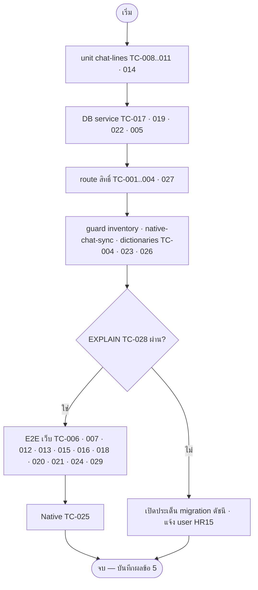

> **โมดูล:** 00097 - CAPI Event Log per Chat and Order
> **ประเภทเอกสาร:** Test Case
> **เวอร์ชัน:** 0.1
> **วันที่จัดทำ:** 2026-11-16
> **สถานะ:** Draft — ยังไม่ได้รัน
> **เจ้าของเอกสาร:** QA (ดู [[Feature-Docs-Ownership]])

# Test Case: ดูเหตุการณ์ Conversions API ในห้องแชทและในคำสั่งซื้อ

---

## 1. Overview

ชุดทดสอบครอบ: สิทธิ์และการไม่รั่ว · การรวมกลุ่ม/ผลของกลุ่ม · การแทรกในไทม์ไลน์และรวมบรรทัด · คำ "Meta รับแล้ว" · การอัปเดตเอง · แถบเพจหยุดส่ง · ขอบเขตคำสั่งซื้อ · ตัวกรองหน้าบันทึก · คำเตือนลบชุดข้อมูล · แชท Native · ด่าน CI

ประเภท: unit (Vitest — `src/lib/meta-capi/__tests__/chat-lines.test.ts`) · DB integration (`src/services/__tests__/meta-capi-settings.db.test.ts` ต่อยอด) · route (`src/app/api/chat/conversations/[id]/capi-events/__tests__/route.test.ts`) · guard (route-capability-inventory · native-chat-sync · i18n dictionaries) · E2E/browser (Playwright + Chrome DevTools ที่ `seller.deepth.local:4000`) · ตรวจด้วยตาบนแอป Native

- **เอกสารต้นทาง:** [[BRD]] ของโมดูลนี้ (ทุก scenario trace กลับ FR-XXX / BR-XXX)
- **ขอบเขตชุดทดสอบ (Scope):** in — FR-001..011 · out — ตัวส่ง/คิว 00089 (มีเทสของตัวเอง) · Meta Events Manager
- **สภาพแวดล้อม:** dev local (Postgres `localhost:5434` — 🛑 HR13/HR14: ทุกคำสั่งเทส DB ปักหมุด `DATABASE_URL` localhost ในคำสั่ง · ลบเฉพาะ id ที่เทสสร้าง) · env `OPEN_META_CAPI=1` + `META_CAPI_PILOT_SHOP_IDS=<ร้านเทส>` · บัญชี OWNER (มี X9) + บัญชีสมาชิกบทบาท CHAT (ไม่มี X9) + บัญชีร้านอื่น · ชุดข้อมูลตั้งต้น: เพจ Messenger 1 เพจ 2 ชุดข้อมูล ("หลัก", "เว็บ") · ห้อง Messenger A · ห้อง LINE B · คำสั่งซื้อ O1 (ผูกห้อง A) · O2 (ไม่ผูกห้อง แต่ส่งการ์ดในห้อง A)

---

## 2. Test Scenarios

### TC-001: ผู้ไม่มี X9 เรียก API ได้ 403 และไม่มีข้อมูล
- **Linked to:** FR-005 · FR-011 · BR-VIS-01 · BR-PII-01
- **Precondition:** สมาชิกร้านบทบาท CHAT (ไม่มี X9) · ห้อง A มีแถวบันทึก 3 เหตุการณ์
- **Steps:**
  1. `GET /api/chat/conversations/{A}/capi-events` ด้วย session CHAT
- **Expected Result:** HTTP 403 body = `FORBIDDEN_ROLE_BODY` · ไม่มี key `groups` · header no-store

### TC-002: คนนอกร้าน / ห้องไม่มี ได้ 404
- **Linked to:** FR-011 · BR-VIS-01 · BR-EDGE-06
- **Precondition:** OWNER ของร้านอื่น · uuid ห้องที่ไม่มีอยู่
- **Steps:**
  1. เรียกด้วย OWNER ร้านอื่น กับห้อง A
  2. เรียกด้วย OWNER ร้านเทส กับ uuid สุ่ม
  3. เรียกด้วย `id=abc`
- **Expected Result:** 1–2 = 404 ไม่มี `groups` (ไม่ยืนยันว่าห้องมีอยู่) · 3 = 400

### TC-003: ไม่ล็อกอิน 401 · ฟีเจอร์ปิด 404 FEATURE_DISABLED
- **Linked to:** FR-011 · BR-VIS-02
- **Precondition:** ห้อง A
- **Steps:**
  1. เรียกโดยไม่มี session
  2. ตั้ง `OPEN_META_CAPI` ว่าง แล้วเรียกด้วย OWNER
  3. ตั้ง `META_CAPI_PILOT_SHOP_IDS` เป็นร้านอื่น แล้วเรียกด้วย OWNER
- **Expected Result:** 1 = 401 · 2–3 = 404 `{code:"FEATURE_DISABLED"}` ไม่มี `groups`

### TC-004: route ประกาศ X9 และผ่านเทส inventory
- **Linked to:** FR-011
- **Precondition:** โค้ด route ใหม่
- **Steps:**
  1. รัน `src/lib/__tests__/route-capability-inventory.test.ts`
  2. ลบบรรทัดประกาศใน `route-capabilities.ts` ชั่วคราว (mutation) แล้วรันซ้ำ
- **Expected Result:** 1 เขียว · 2 แดง (เทสจับได้) · คืนบรรทัดแล้วเขียว

### TC-005: response ไม่มีข้อมูลดิบ/PII
- **Linked to:** BR-PII-01 · FR-011
- **Precondition:** แถวมี `psid` `lastRequest` `lastResponse` `lastHttpStatus` `reason='TOKEN_OR_PERMISSION'` `payload.items`
- **Steps:**
  1. OWNER เรียก `capi-events`
  2. เดินทุก key ของ JSON (recursive) เทียบ allow-list ใน [[API]] §4.1
  3. ค้นสตริงค่า psid / ค่า reason ดิบ ใน body
- **Expected Result:** ไม่มี key นอก allow-list · ไม่พบค่า psid · `reason` ดิบไม่ปรากฏ (มีแค่ `reasonKey`)

### TC-006: หน้าเว็บของผู้ไม่มี X9 ไม่ยิงคำขอและไม่มีบรรทัด
- **Linked to:** FR-005 · D1
- **Precondition:** ล็อกอิน CHAT · เปิดห้อง A บนเว็บ
- **Steps:**
  1. เปิดห้อง ดู Network
  2. ค้น DOM หา `ส่ง “` / `ให้ Meta`
- **Expected Result:** ไม่มีคำขอ `capi-events` · ไม่มีบรรทัด/แถบ · HTML ของ RSC ไม่มีข้อมูลเหตุการณ์

### TC-007: ห้องไม่ใช่ Messenger
- **Linked to:** FR-005 · BR-VIS-03 · D8
- **Precondition:** OWNER · ห้อง LINE B
- **Steps:**
  1. เปิดห้อง B บนเว็บ
  2. เรียก API ตรงกับห้อง B
- **Expected Result:** 1 ไม่ยิงคำขอ ไม่มีบรรทัด · 2 = 200 `{visible:false, groups:[]}`

### TC-008: รวมกลุ่มตาม dedupeKey + ผลของกลุ่ม
- **Linked to:** BR-GRP-01 · BR-GRP-02 · BR-GRP-03 · D11
- **Precondition:** unit — แถวชุดทดสอบ
- **Steps:**
  1. `groupCapiRows`: 2 แถว dedupeKey เดียว (หลัก SENT, เว็บ PENDING retrying) + 1 แถวอีก dedupeKey
  2. `capiGroupResult` ทุกกรณี: ทุกชุด SENT · ทุกชุด FAILED · SENT+PENDING · SENT+SKIPPED · FAILED+PENDING · ทุกชุด queued · queued+SENT
  3. ชุดที่ `label=null`
- **Expected Result:** 2 กลุ่ม · `at` = createdAt เก่าสุดของกลุ่ม · uniform/mixed/sending ตามนิยาม · `worst` = FAILED > PENDING > SKIPPED > SENT · `okCount` นับชุด SENT · queued+SENT = mixed (ไม่ใช่ sending) · label null → UI ใช้ datasetId · mutation: สลับลำดับ worst / นับแถวแทนกลุ่ม ต้องทำให้เทสแดง

### TC-009: แทรกบรรทัดตามเวลาและตัวคั่นวัน
- **Linked to:** FR-001 · BR-GRP-02
- **Precondition:** unit — ข้อความ 4 ใบ (10:00, 11:00, 11:30 วันที่ 16 · 09:00 วันที่ 17) · กลุ่มที่ 10:30, 11:30 (เท่ากับข้อความ), 08:00 วันที่ 18 (ไม่มีข้อความวันนั้น)
- **Steps:**
  1. `buildCapiTimeline(messages, groups, {hasOlder:false})`
  2. จัดวันด้วย `groupByDate` ที่ขยายแล้ว
- **Expected Result:** ลำดับ msg10:00 · capi10:30 · msg11:00 · msg11:30 · capi11:30 (ข้อความมาก่อนเมื่อเวลาเท่ากัน) · msg09:00(17) · วันที่ 18 มีตัวคั่นวันของตัวเองพร้อมบรรทัด 08:00

### TC-010: ซ่อนบรรทัดที่เก่ากว่าข้อความที่โหลด
- **Linked to:** FR-001 (AC ข้อความเก่า)
- **Precondition:** unit — ข้อความแรกที่โหลด 12:00 · กลุ่ม 11:00
- **Steps:**
  1. `hasOlder:true`
  2. `hasOlder:false`
- **Expected Result:** 1 ไม่มีบรรทัด 11:00 · 2 มีบรรทัด 11:00 ก่อนข้อความ 12:00 · E2E: เลื่อนขึ้นโหลดข้อความเก่าแล้วบรรทัดโผล่

### TC-011: รวมบรรทัดที่ติดกัน (collapse)
- **Linked to:** FR-002 · BR-GRP-04 · D5
- **Precondition:** unit
- **Steps:**
  1. 3 กลุ่มติดกันวันเดียว ทุกกลุ่ม SENT ทุกชุด
  2. 3 กลุ่มติดกัน: SENT · mixed · FAILED
  3. 2 กลุ่มติดกัน ทุกกลุ่ม queued
  4. 2 กลุ่มคั่นด้วยข้อความ 1 ใบ
  5. 2 กลุ่มติดกันแต่ข้ามวัน (23:59 / 00:01 เวลาไทย)
  6. ข้อความ META_NOTICE คั่น
- **Expected Result:** 1 = 1 item `groups.length=3` ข้อความ "ส่ง 3 event ให้ Meta · Meta รับแล้วทั้งหมด" · 2 = "Meta รับแล้ว 1 จาก 3" ไอคอน FAILED · 3 = "กำลังส่ง 2 event ให้ Meta…" · 4,5,6 = ไม่รวม (2 item) · `{n}`/`{ok}` นับกลุ่มไม่ใช่แถว

### TC-012: หน้าตาและคำของบรรทัดเดี่ยว
- **Linked to:** FR-001 · BR-TXT-02..06 · D6 · D9
- **Precondition:** E2E OWNER · ห้อง A มี PURCHASE (หลัก SENT, เว็บ retrying attempts=1) · ADD_PAYMENT_INFO (SENT) · ORDER_CANCELED (FAILED rejected) · VIEW_CONTENT (SKIPPED tooOld)
- **Steps:**
  1. เปิดห้อง A
  2. อ่านข้อความแต่ละบรรทัด + ตรวจโครง (ไม่มีรูปโปรไฟล์ ไม่มีปุ่มคัดลอก/ตอบกลับ/รีแอค · `my-5 px-4 text-center`)
  3. กดบรรทัด PURCHASE
  4. ภาษา EN
- **Expected Result:** `ส่ง “แนบสลิป” ให้ Meta · ฿1,070 · {HH:MM} · Meta รับแล้ว` · PURCHASE แสดง "Meta รับแล้ว 1 จาก 2" · ยกเลิก "ล้มเหลว · Meta ไม่บันทึก" สี danger-ink · ดูสินค้า "ข้าม · เก่ากว่า 7 วัน" · กางแล้ว `aria-expanded=true` เห็น "หลัก · Meta รับแล้ว · Meta รับเมื่อ {date}" + "เว็บ · รอ · ลองใหม่ครั้งที่ 1 จาก 3" + ลิงก์ `/settings/capis/{channelId}/log?conversation={A}` · ไม่มีคำว่า "สำเร็จ" · ไม่มีคำว่า "Deep" · ไม่มี emoji · EN ใช้ "Received by Meta"

### TC-013: "กำลังส่ง" แล้วเปลี่ยนเป็นผลเอง
- **Linked to:** FR-003 · TFR-004
- **Precondition:** E2E OWNER · ห้อง A · ฟีเจอร์เปิด · cron ไม่รัน (คุมด้วยมือ)
- **Steps:**
  1. ยืนยันชำระเงินออเดอร์ O1 ในห้อง → แถว PURCHASE queued
  2. เห็นบรรทัดจาง "กำลังส่ง “ซื้อ” ให้ Meta…" (`role=status` · ไม่มีปุ่มกาง)
  3. อัปเดตแถวเป็น SENT + sentAt (สคริปต์ scope id)
  4. รอ ≤ 15 วิ ไม่รีโหลด
  5. ตั้ง `prefers-reduced-motion: reduce`
- **Expected Result:** 4 บรรทัดเปลี่ยนเป็น "Meta รับแล้ว" · Network: คำขอทุก ~10 วิ ขณะมี queued แล้วเปลี่ยนเป็น ~60 วิ · 5 ไอคอนไม่หมุน · ไม่มี `router.refresh` ในห้อง

### TC-014: รอบรีเฟรชและการหยุด
- **Linked to:** FR-003 · TFR-004
- **Precondition:** unit `capiNeedsFastRefresh` + E2E
- **Steps:**
  1. unit: groups มี queued → true · retrying → true · waitToken อย่างเดียว → false · ว่าง → false
  2. E2E: ซ่อนแท็บ 2 นาที ดู Network · กลับมาที่แท็บ
  3. E2E: ข้อความใหม่เข้าห้อง (realtime)
  4. ทำให้ route ตอบ 403 (เปลี่ยนบทบาทระหว่างเปิด) แล้วรอ 2 รอบ
- **Expected Result:** 2 ไม่มีคำขอขณะซ่อน · มี 1 คำขอทันทีเมื่อกลับมา · 3 มีคำขอตามข้อความใหม่ · 4 บรรทัดหาย และไม่มีคำขอซ้ำในห้องนั้น

### TC-015: แถบ "เพจหยุดส่ง"
- **Linked to:** FR-004 · D13 · BR-EDGE-03
- **Precondition:** E2E OWNER · ห้อง A · แถว PENDING `reason=TOKEN_OR_PERMISSION`
- **Steps:**
  1. ตั้งทั้ง 2 ชุดข้อมูล `STOPPED` · เปิดห้อง
  2. ตั้งชุด "เว็บ" กลับ `ACTIVE` · รีเฟรชรอบถัดไป
  3. ปิดเพจ (`MetaCapiPageSetting.enabled=false`) ขณะทุกชุด STOPPED
- **Expected Result:** 1 แถบเดียว "หยุดส่ง · ต้องเชื่อมเพจใหม่" + ลิงก์ `/settings/capis/{channelId}` · บรรทัดที่ค้างแสดง "รอ" ไม่มี "รอเชื่อมเพจใหม่" · กางแล้วเห็นเหตุผลเต็ม · 2 แถบหาย บรรทัดของชุดหลักแสดง "รอ · รอเชื่อมเพจใหม่" · 3 ไม่มีแถบ (สถานะเพจ off)

### TC-016: บรรทัดไม่รั่วออกนอกห้อง
- **Linked to:** BR-VIS-04 · D4 · TFR-010
- **Precondition:** DB + E2E · ห้อง A มีบรรทัด
- **Steps:**
  1. นับ `ChatMessage` ของห้อง A ก่อน/หลังเปิดห้องและรีเฟรช 3 รอบ
  2. ดูรายการแชท (พรีวิวข้อความล่าสุด · ตัวนับยังไม่อ่าน) · ค้นหาข้อความ "ให้ Meta"
  3. เปิดห้องเดียวกันในฝั่งลูกค้า (Messenger บัญชีทดสอบ)
  4. สลับห้อง A → C → A (แคชสลับห้อง)
- **Expected Result:** จำนวนแถวไม่เปลี่ยน · พรีวิว/ตัวนับ/ค้นหาไม่มีบรรทัด · ลูกค้าไม่เห็นอะไรใหม่ · กลับมาห้อง A บรรทัดมาจากการดึงใหม่ ไม่ใช่จาก store ข้อความ

### TC-017: เพดาน 300 แถว
- **Linked to:** BR-EDGE-08 · TFR-002
- **Precondition:** DB — ห้องที่มี 301 แถว (101 กลุ่ม × 3 ชุด − ตัดกลาง)
- **Steps:**
  1. เรียก `listConversationCapiEvents`
- **Expected Result:** `truncated:true` · ไม่มีกลุ่มที่ชุดข้อมูลขาด (กลุ่มเก่าสุดที่อาจไม่ครบถูกทิ้ง) · ทุกแถวที่คืนเป็นของร้านเทส

### TC-018: เพจที่ยกเลิกการเชื่อม
- **Linked to:** BR-EDGE-09
- **Precondition:** ห้อง A มีบรรทัด · ตั้ง `ShopChannel.status=DISCONNECTED`
- **Steps:**
  1. เรียก API · เปิดห้อง
- **Expected Result:** `channelId:null` `pageStopped:false` · บรรทัดยังแสดง · กล่องกางไม่มีลิงก์ "ดูในบันทึกการส่ง" · ไม่มีแถบ

### TC-019: การ์ดคำสั่งซื้อ — ขอบเขตแถว
- **Linked to:** FR-007 · BR-SCOPE-02 · D7
- **Precondition:** DB — O1 ผูกห้อง A มีแถว ORDER_CREATED/PURCHASE · ห้อง A มีแถว VIEW_CONTENT + QUALIFIED_LEAD (ไม่มี orderId) · O2 ไม่ผูกห้อง แต่การ์ด O2 ส่งในห้อง A → INITIATE_CHECKOUT `payload.orderId=O2` · ร้านอื่นมีแถว `payload.orderId=O1` (ปลอม)
- **Steps:**
  1. `listOrderCapiEvents(shop, O1)`
  2. `listOrderCapiEvents(shop, O2)`
  3. mutation: ตัดเงื่อนไข `shopId` / ตัด convSet จากการ์ด
- **Expected Result:** 1 = ORDER_CREATED + PURCHASE เท่านั้น (ไม่มี VIEW_CONTENT/LEAD · ไม่มีแถวร้านอื่น) เรียงใหม่ → เก่า · 2 = INITIATE_CHECKOUT (`show:true` แม้ไม่ผูกห้อง) · 3 เทสแดงทั้งสองแบบ

### TC-020: การ์ดคำสั่งซื้อ — การแสดง/ไม่แสดง
- **Linked to:** FR-007 · BR-SCOPE-03 · BR-EDGE-04 · BR-EDGE-07
- **Precondition:** E2E
- **Steps:**
  1. OWNER เปิด O1 (มีแถว)
  2. OWNER เปิดคำสั่งซื้อผูกห้อง Messenger ไม่มีแถว เพจเปิดส่ง
  3. เหมือน 2 แต่เพจปิด
  4. OWNER เปิดคำสั่งซื้อไม่ผูกห้อง ไม่เคยส่งการ์ด
  5. OWNER เปิดคำสั่งซื้อ dry-run
  6. CHAT/ผู้มี O1 แต่ไม่มี X9 เปิด O1
  7. ทำให้ service throw (ปิด DB ชั่วคราวไม่ได้ → mock ในเทส RSC)
- **Expected Result:** 1 การ์ดใต้ "ประวัติออเดอร์" ป้าย "Meta รับแล้ว" + "Meta รับเมื่อ {date}" · ปุ่ม `/settings/capis/{ch}/log?order={publicToken}` · 2 "ยังไม่มีการส่ง event" · 3 "เพจ {ชื่อ} ยังไม่ได้เปิด Conversions API" + "ไปตั้งค่า" · 4,5,6 ไม่มีการ์ด (6: HTML ไม่มีข้อมูลเหตุการณ์) · 7 "โหลด event ไม่สำเร็จ" + "ลองใหม่" การ์ดอื่นปกติ

### TC-021: หน้าบันทึก — ตัวกรองแชท
- **Linked to:** FR-008 · D12
- **Precondition:** E2E OWNER · เพจมีแถวจากห้อง A และห้อง C
- **Steps:**
  1. เปิด `/settings/capis/{ch}/log?conversation={A}`
  2. เพิ่ม `&status=SENT` · กด "โหลดเพิ่ม"
  3. กด × บนชิป
  4. เปิดด้วย `?conversation={ห้องของร้านอื่น}` และ `?conversation=abc`
- **Expected Result:** 1 ชิป "แชท: {ชื่อลูกค้า A}" · เฉพาะแถวห้อง A · ไม่มีคอลัมน์ "ลูกค้า" (desktop + mobileCard) · แถว SENT มี "Meta รับเมื่อ {date}" · ป้ายมีไอคอน · 2 คำขอ API มี `conversation=` + `status=` · 3 กลับเป็นรายการทั้งเพจ คอลัมน์ลูกค้ากลับมา · 4 ไม่มีชิป ไม่กรอง ไม่มี error

### TC-022: หน้าบันทึก — ตัวกรองคำสั่งซื้อ + API
- **Linked to:** FR-008 · TFR-007
- **Precondition:** O1, O2 ตาม TC-019
- **Steps:**
  1. เปิด `…/log?order={O2.publicToken}`
  2. `GET /api/shops/meta-capi/{ch}/log?order={O1.publicToken}`
  3. `GET …/log?order=<token ร้านอื่น>` · `?order=` ยาว 65 ตัว · `?conversation=abc`
- **Expected Result:** 1 ชิป "ออเดอร์ #{orderNo ?? 8 ตัวแรก}" · เฉพาะ INITIATE_CHECKOUT ของ O2 · 2 เฉพาะแถว O1 ของเพจนี้ มี `sentAt` · 3 = `rows: []` · 400 `INVALID_INPUT` · 400 `INVALID_INPUT`

### TC-023: คำ "Meta รับแล้ว" ทั้งระบบ
- **Linked to:** FR-009 · D9 · HR16
- **Precondition:** โค้ดหลังแก้
- **Steps:**
  1. ตรวจ `th.ts`: `conversionsApi.logStatus.SENT` · `statsSent`
  2. `rg -n "สำเร็จ" src/app/(paces)/seller/(dashboard)/settings/capis src/app/(paces)/seller/(chat)` แล้วไล่ทุกจุดที่หมายถึงสถานะ SENT
  3. เปิดหน้าบันทึก (ตัวกรองสถานะ · ป้าย) · การ์ดสถิติ · บรรทัดห้อง · การ์ดคำสั่งซื้อ
  4. รัน `src/i18n/__tests__/dictionaries.test.ts`
- **Expected Result:** "Meta รับแล้ว" ทุกจุด · ไม่มี "สำเร็จ" ที่หมายถึง SENT · สถานะอื่นยังเป็น รอ/ล้มเหลว/ข้าม · th/en มีคีย์ครบ (เทสเขียว)

### TC-024: คำเตือนลบชุดข้อมูล
- **Linked to:** FR-010 · D10
- **Precondition:** E2E OWNER · เพจมี 2 ชุดข้อมูล
- **Steps:**
  1. กดลบชุดข้อมูล "เว็บ"
- **Expected Result:** กล่องยืนยัน (Swal) มีประโยค "บันทึกการส่งของชุดนี้จะถูกลบด้วย" · กด "ไม่ลบ" ไม่มีอะไรเปลี่ยน

### TC-025: แชท Native — บรรทัดเท่าเว็บ
- **Linked to:** FR-006 · BR-NAT-01 · D3
- **Precondition:** deep-seller-app build ที่ชี้ dev · บัญชี OWNER · โหมดแชท Native · ห้อง A ตาม TC-012
- **Steps:**
  1. เปิดห้อง A ใน Native · เทียบทุกบรรทัดกับเว็บ (ข้อความ · ลำดับ · รวมบรรทัด · ผล · เหตุผลสั้น)
  2. กางบรรทัด PURCHASE · กด "ดูในบันทึกการส่ง"
  3. ทำ TC-013 ขั้น 1–4 ในแอป (สลับแอปไป background แล้วกลับมาด้วย)
  4. ทำ TC-015 ขั้น 1 ในแอป
  5. ล็อกอิน CHAT เปิดห้อง A ใน Native · ดู log คำขอ
  6. เปิดห้อง LINE B
- **Expected Result:** 1–4 ตรงกับเว็บทุกตัวอักษร (ไม่มี emoji · ไอคอนจริง) · 2 เปิดหน้าบันทึกบนเว็บที่กรองแชท · 5 คำขอเดียวได้ 403 แล้วไม่ยิงซ้ำ ไม่มีบรรทัด · 6 ไม่มีบรรทัด

### TC-026: ด่าน native-chat-sync
- **Linked to:** FR-006 · HR18
- **Precondition:** branch ฟีเจอร์
- **Steps:**
  1. รัน `src/lib/__tests__/native-chat-sync.test.ts` ก่อนปักหมุด
  2. ตรวจ manifest มี `SyncEntry` ของ `chat-lines.ts` · `ui.ts` (capiReasonKey) · `events.ts` · ก้อนคำ th
  3. แก้ `chat-lines.ts` 1 ตัวอักษร (mutation) รันซ้ำ
  4. PR เว็บมี `Native: <PR แอป>`
- **Expected Result:** 1 แดง (ไฟล์ใหม่ใต้โฟลเดอร์ที่เฝ้า) · หลังทำแอป + ปักหมุด = เขียว · 3 แดง · 4 มีบรรทัด

### TC-027: ห้อง/ออเดอร์ของร้านในกล่องแชทรวม
- **Linked to:** FR-011 · TD-004
- **Precondition:** ผู้ใช้เป็น OWNER ร้าน S1 และ CHAT ร้าน S2 · โหมดกล่องแชทรวม · ร้าน active = S1
- **Steps:**
  1. เรียก `capi-events` กับห้องของ S2
  2. เป็น OWNER ทั้ง S1/S2 · ร้าน active = S1 · เรียกกับห้องของ S2
- **Expected Result:** 1 = 403 (ตัดสินด้วยบทบาทในร้านของห้อง ไม่ใช่ร้าน active) · 2 = 200 ข้อมูลของ S2

### TC-028: แผน query ใช้ดัชนีห้อง
- **Linked to:** NFR Performance · [[DATABASE]] §5
- **Precondition:** dev ที่ seed ≥ 20,000 แถว ≥ 5 ร้าน · `ANALYZE "MetaCapiEvent"` (ปักหมุด URL localhost ในคำสั่ง — HR14)
- **Steps:**
  1. `EXPLAIN (ANALYZE, BUFFERS)` Q1 · Q2 · Q3 ตาม [[DATABASE]] §4
- **Expected Result:** ใช้ `MetaCapiEvent_conversationId_eventKey_createdAt_idx` (ไม่ใช่ backward scan ของ `shopId_createdAt` ทั้งร้าน) · เวลา < 50 ms · ไม่ผ่าน → เปิดประเด็น migration ดัชนี (HR15)

### TC-029: การเข้าถึงได้ (a11y) + เป้ากด
- **Linked to:** FR-001 · FR-003 · BRD §6.5
- **Precondition:** E2E มือถือ 390 / แท็บเล็ต 834 / desktop 1440 · light/dark
- **Steps:**
  1. Tab ไปที่บรรทัด · Enter กาง/หุบ
  2. วัดความสูงปุ่มบรรทัด/ลิงก์/ปุ่ม × ชิป
  3. ตรวจคอนทราสต์คำผล
- **Expected Result:** โฟกัสเห็นได้ · `aria-expanded` เปลี่ยน · <1024 ≥ 44px · desktop ≥ 32px · คอนทราสต์ ≥ 4.5:1 ทั้ง light/dark

---

## 3. Traceability Matrix

| AC / FR ใน [[BRD]] | Test Case | ครอบคลุมหรือไม่ |
|---------------------|-----------|------------------|
| FR-001 | TC-009, TC-010, TC-012, TC-029 | Yes |
| FR-002 | TC-011 | Yes |
| FR-003 | TC-013, TC-014, TC-029 | Yes |
| FR-004 | TC-015 | Yes |
| FR-005 | TC-001, TC-006, TC-007 | Yes |
| FR-006 | TC-025, TC-026 | Yes |
| FR-007 | TC-019, TC-020 | Yes |
| FR-008 | TC-021, TC-022 | Yes |
| FR-009 | TC-012, TC-023 | Yes |
| FR-010 | TC-024 | Yes |
| FR-011 | TC-001, TC-002, TC-003, TC-004, TC-005, TC-027 | Yes |
| BR-VIS-01..04 | TC-001, TC-003, TC-006, TC-007, TC-016 | Yes |
| BR-SCOPE-01..03 | TC-017, TC-019, TC-020 | Yes |
| BR-GRP-01..04 | TC-008, TC-009, TC-011 | Yes |
| BR-TXT-01..06 | TC-012, TC-023 | Yes |
| BR-PII-01 | TC-005 | Yes |
| BR-NAT-01 | TC-025, TC-026 | Yes |
| BR-RET-01 | TC-024 | Yes |
| BR-EDGE-03 · 04 · 06 · 07 · 08 · 09 | TC-015, TC-020, TC-002, TC-020, TC-017, TC-018 | Yes |
| NFR Performance | TC-028 | Yes |

> ทุก AC ใน [[BRD]] ต้องปรากฏในตารางนี้และมี TC อย่างน้อย 1 รายการ — AC ที่ไม่มี TC ถือว่าช่องโหว่
> WRITER gate จะ reject ถ้าตารางนี้ไม่ครอบคลุมทุก AC

---

## 4. Flow (ถ้ามี)

> **บังคับ:** ถ้ามี flow/diagram ใด ๆ ในหัวข้อนี้ **ต้องใช้ Mermaid เท่านั้น**
> ห้าม ASCII art, ห้ามรูปภาพ, ห้าม external tool (ดู [[Feature-Docs-Ownership]] §4)

---

## 5. ผลล่าสุด

| Run | วันที่ | ผล (Pass/Fail/Blocked) | ผู้ทดสอบ (Tester) |
|-----|--------|--------------------------|---------------------|
| 1 | — | ยังไม่ได้รัน (ยังไม่มีโค้ด) | — |

---

## 6. สรุป (Summary)

เอกสาร Test Case นี้กำหนด **ชุดเคสทดสอบ** ของ **มุมมองเหตุการณ์ CAPI ต่อห้องและต่อคำสั่งซื้อ** ที่ trace กลับ Acceptance Criteria
ใน [[BRD]] ทุกข้อ เพื่อให้มั่นใจว่าทุกข้อกำหนดเชิงธุรกิจถูกทดสอบครบ

**Open Questions:**
- TC-025 ต้องมี build แอปที่ชี้ dev และบัญชี Messenger ทดสอบ — ยืนยันกับเจ้าของแอปก่อนรอบ QA
